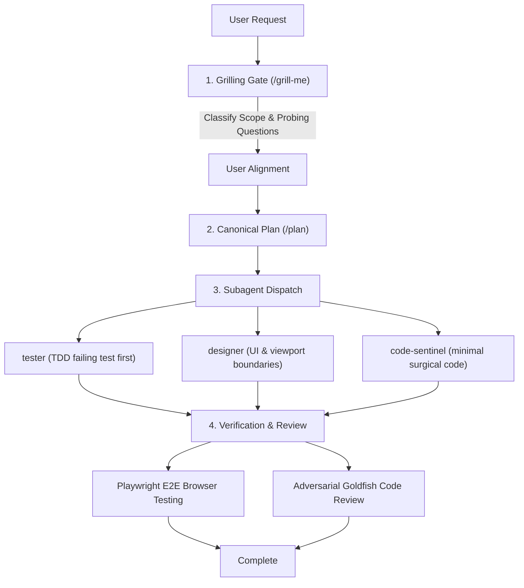

# `heimdall-agent` — Multi-Agent Engineering Sentinel & Environment Bootstrapper

<p align="left">
  <a href="LICENSE"></a>
  <a href="https://nodejs.org">= 18" /></a>
  <a href="#8-predefined-agent-personas"></a>
  <a href="#skill-inventory-50-modules-across-16-toolkits"></a>
  <a href="#supported-tools--runtimes"></a>
</p>

🌐 **Language / Idioma:** **English** | [Português (Brasil)](README.pt-BR.md)

Heimdall is a portable bootstrap toolkit and quality sentinel for multi-agent software engineering. It enforces planning gates before code generation, prevents AI slop, isolates module boundaries, and synchronizes **8 specialized agent personas** and **50 modular skills** across **Google Antigravity**, **Claude Code**, **OpenAI Codex CLI**, **Hermes Agent**, **OpenClaw**, **OpenDesign**, and **Claude Desktop**.

---

<a id="table-of-contents"></a>
## Table of Contents

- [1. What is Heimdall?](#1-what-is-heimdall)
- [2. What it Does](#2-what-it-does)
- [3. How it Works (Architecture, Files & Hooks)](#3-how-it-works)
- [4. How to Install](#4-how-to-install)
- [5. How to Use (CLI & Slash Commands)](#5-how-to-use)
- [6. Full List of Skills & Agents](#6-full-list-of-skills--agents)
- [7. Additional Companion Tools](#7-additional-companion-tools)
- [License](#license)

---

<a id="1-what-is-heimdall"></a>
## 1. What is Heimdall?

**Heimdall** is an environment bootstrapper and multi-agent coordination layer for AI coding tools. 

Instead of manually maintaining scattered custom instructions, system prompts, and configuration files across different AI clients, Heimdall provides a single source of truth:
* **Modular Skills**: 50 task-activated capabilities (such as database design, security audits, design token enforcement, and debugging) that load on demand instead of wasting prompt tokens.
* **Specialized Agent Personas**: 8 predefined roles with isolated context windows (`orchestrator`, `tester`, `frontend-designer`, `mobile-designer`, `reviewer`, `security-auditor`, `database-architect`, `code-sentinel`).
* **Universal Doctrine**: Central rules (`AGENTS.md`) synchronized across all harnesses, enforcing planning gates, test-driven development (TDD), and minimal surgical code edits.

Heimdall runs on **Windows, macOS, and Linux**, using native filesystem junctions and symlinks to keep all AI harnesses synchronized with zero file duplication.

[↑ Back to top](#table-of-contents)

---

<a id="2-what-it-does"></a>
## 2. What it Does

Heimdall transforms unconstrained AI coding assistants into disciplined, multi-agent engineering teams:

1. **Enforces Interactive Planning Gates**: Halts immediate code generation on complex tasks. Interrogates requirements, asks probing questions on failure modes, and presents architectural alternatives before locking the plan.
2. **Eliminates AI Slop & Restrains Code**: Enforces Karpathy simplicity guidelines (50 lines over 200, surgical edits only) and purges AI conversational fluff, boilerplate comments, and decorative CSS defaults.
3. **Implements Test-Driven Development (TDD)**: Requires failing automated tests before writing implementation code. Prohibits pseudo-verification (`curl 200`, `grep`, container status).
4. **Mandates Playwright E2E Browser Testing**: Requires active Playwright browser verification for any interactive UI or user-facing changes.
5. **Adversarial Peer Review**: Dispatches context-blinded reviewers to inspect git diffs for edge cases, silent regressions, and unhandled failure branches.
6. **Intercepts Dangerous Operations**: Evaluates shell commands and file mutations via lifecycle hooks to block destructive root wiping and force-pushes to protected branches.

### Comparison: Vanilla AI Coding vs. Heimdall

| Area | Vanilla AI Coding | With Heimdall |
| :--- | :--- | :--- |
| **Initial Prompt** | AI immediately generates 300 lines of unverified code. | **Interactive Gate**: AI pauses, interrogates edge cases, and presents 2 architectural options. |
| **Code Review** | AI rubber-stamps its own code with conversational praise. | **Context-Blinded Review**: Stateless reviewer inspects diffs without conversational bias. |
| **Code Restraint** | Bloated wrappers, defensive boilerplate, speculative options. | **Karpathy Simplicity**: Minimum code, surgical edits, zero unprompted refactoring. |
| **Verification** | AI claims "done!" without testing or relies on shallow checks. | **TDD & Playwright**: Failing test first; active browser DOM assertions for UI. |
| **Safety** | AI can execute destructive commands or force push to main. | **Lifecycle Hooks**: Blocks `rm -rf /` and force pushes to `main`/`master` at runtime and Git level. |
| **Configuration** | Scattered, drifting prompt files across multiple tools. | **Single Source of Truth**: Linked via native junctions/symlinks in 1 second. |

[↑ Back to top](#table-of-contents)

---

<a id="3-how-it-works"></a>
## 3. How it Works (Architecture, Files & Hooks)

Heimdall sits between your AI coding clients and your codebase, deploying standardized files, hooks, and doctrine across your system.

### 1. Files & Directories Touched

When Heimdall bootstraps, it establishes live junctions (Windows) or symlinks (POSIX) from this repository to your target tool configuration directories:

| Source in Heimdall | Deployed Location | Purpose |
| :--- | :--- | :--- |
| `skills/` | `~/.<tool>/skills/` | 50 domain toolkits loaded progressively on demand. |
| `agents/` | `~/.<tool>/agents/` | 8 specialized agent persona definitions. |
| `hooks/` | `~/.claude/hooks/` | Event-driven lifecycle hooks for Claude Code CLI. |
| `hooks/git/` | `.git/hooks/` (optional) | Universal native Git pre-push hook for all tools. |
| `doctrine/AGENTS.md` | `~/.claude/CLAUDE.md`<br>`~/.gemini/GEMINI.md`<br>`~/.codex/AGENTS.md`<br>`~/.hermes/AGENTS.md` | Universal cross-agent doctrine and operational constraints. |
| `playbooks/` | `~/.<tool>/playbooks/` | Operational playbooks (grilling gate, TDD, reviews, plans). |
| `commands/` | `~/.claude/commands/` | Slash commands (`/orchestrator`, `/orchestrate`, `/plan`, `/grill-me`). |
| `tools/` | `PATH` candidate directory | Cross-model bridge scripts (`claude-bridge`, `gemini-bridge`, `codex-bridge`) and `heimdall` CLI. |

### 2. The Google Elephant-Goldfish Model (EGM)

Heimdall adopts the core division of labor from [`google/elephant-goldfish-model`](https://github.com/google/elephant-goldfish-model):

* **The Elephant (Coordinator)**: The primary session and [`orchestrator`](#8-predefined-agent-personas) persona retain long-term memory, project narrative, and deep contextual history.
* **The Goldfish (Reviewers & Testers)**: Subagents dispatched for code review (`reviewer`) and bug diagnosis (`tester`) are intentionally blinded to conversational backstory and author debates. They evaluate raw git diffs and acceptance criteria directly, preventing confirmation bias and rubber-stamping.
* **The 3-Tier Boundary Ladder**:
  - **Tier 1 (Spike / Bugfix < 50 LOC)**: Zero ceremony. Minimal surgical code with a failing test first.
  - **Tier 2 (Bounded Feature)**: Fast in-chat design check with critic and readiness reviews.
  - **Tier 3 (Architectural)**: Spec written to disk (`docs/designs/<feature>.md`), 4-stage review (Zoom Out, Comprehension, Critique, Readiness), and a 5-round convergence ledger.
* **Adaptive Multi-Model Execution**: If cross-model bridges (`gemini-bridge.ps1`, `claude-bridge.ps1`, `codex-bridge.ps1`) and credentials exist, Heimdall routes reviews across different models (e.g. Gemini Elephant validated by Claude/Codex); otherwise, it falls back to stateless child subagents on the same model.

### 3. Event-Driven Lifecycle Hooks

Heimdall includes zero-dependency runtime hooks ([`hooks/heimdall-hook.cjs`](hooks/heimdall-hook.cjs)) registered in `~/.claude/settings.json`:

* **`PreToolUse` (Bash/PowerShell)**:
  - **Blocks Destructive Commands**: Halts operations like `rm -rf /` or `rmdir /s /q C:\` (exit code 2).
  - **Branch-Aware Force Push Protection**: Blocks `git push --force` targeting `main`, `master`, `release`, or `production` (explicitly or while checked out on those branches). Force pushes to feature branches (`feature/*`, `bugfix/*`) are permitted with an advisory.
  - **Blocks Secret Commits**: Halts staging unencrypted `.env`, `id_rsa`, or `*.pem` files.
* **`PreToolUse` (Write)**:
  - **Karpathy Restraint Warning**: Emits an advisory if an AI attempts to generate a single file exceeding 800 lines.
* **`PostToolUse` (Edit/Write)**:
  - **Verification Reminder**: Emits a reminder to run automated tests or browser verification before concluding.
* **`PreCompact`**:
  - **Compaction State Reminder**: Reminds the agent to persist unresolved decisions and active task ledgers to disk before context compression.
* **Universal Native Git Pre-Push Hook** ([`hooks/git/pre-push`](hooks/git/pre-push)):
  - Shell hook installable into any repository (`.git/hooks/pre-push`) that blocks non-fast-forward pushes to `main`/`master` universally across all AI harnesses and terminal users.

*(See [Section 6: Full List of Skills & Agents](#6-full-list-of-skills--agents) for detailed skill and persona inventories).*

[↑ Back to top](#table-of-contents)

---

<a id="4-how-to-install"></a>
## 4. How to Install

### Quick Automated Installation (Recommended)

Clone the repository and run the setup script with live junctions:

```powershell
# 1. Clone repository
git clone https://github.com/bepaldes/heimdall-agent.git
cd heimdall-agent

# 2. Bootstrap full ecosystem with live junctions
node setup.mjs --clean --link --yes
```

> **Interactive Wizard**: Run `node setup.mjs` without flags to interactively select specific AI tools, destination paths, and profiles.

### Installation Profiles

Select a profile tier based on your machine and workflow needs:

| Profile | Skills | Predefined Agents | Description | Best For |
| :--- | :---: | :---: | :--- | :--- |
| **`full`** *(Default)* | 50 | 8 | Complete engineering suite: planning, design, security, database, hygiene. | Everyday development across all tools |
| **`minimal`** | 16 | 4 | Lean core: `orchestrator`, `tester`, `code-sentinel`, `reviewer`. | Lightweight laptops, smaller context windows |
| **`security`** | 12 | 4 | AppSec suite: `orchestrator`, `security-auditor`, `tester`, `reviewer`. | Penetration testing & pre-deployment audits |
| **`design`** | 14 | 4 | Frontend & mobile: `orchestrator`, `frontend-designer`, `mobile-designer`, `code-sentinel`. | UI/UX design and design-system work |

To deploy a specific profile:
```powershell
node setup.mjs --profile minimal --link --clean --yes
```

<a id="supported-tools--runtimes"></a>
### Supported Tools & Runtimes

Heimdall automatically discovers and configures installed AI tools:

| Tool | Detection Target | Integration Method |
| :--- | :--- | :--- |
| **Claude Code CLI** | `claude` on PATH | Junctions to `~/.claude/skills`, `agents`, `commands`, `hooks` + settings injection |
| **Google Antigravity** | `agy` on PATH | Junctions to `~/.gemini/skills`, `agents`, and universal `.agents/` |
| **OpenAI Codex CLI** | `codex` on PATH | Junctions to `~/.codex/skills`, `agents`, and `AGENTS.md` |
| **Hermes Agent** | `hermes` on PATH / LocalAppData | Junctions to `%LOCALAPPDATA%\hermes\skills` + `external_dirs` in `config.yaml` |
| **OpenClaw** | `openclaw` on PATH | Junctions to `~/.openclaw/skills` + `AGENTS.md` / `SOUL.md` injection |
| **OpenDesign** | `open-design` on PATH / `.opendesign` | Automatic visual canvas mode: bypasses Turn 1 grilling gate, preserves `data-od-*` attributes & applies `taste-skill` + `antislop-ui` |
| **Claude Desktop** | `%APPDATA%\Claude` | Auto-configures Context7 MCP and playbooks in `claude_desktop_config.json` |

[↑ Back to top](#table-of-contents)

---

<a id="5-how-to-use"></a>
## 5. How to Use (CLI & Slash Commands)

### 1. Daily CLI Commands (`heimdall` / `node setup.mjs`)

Setup creates a global `heimdall` executable on your PATH (or run `npm link`). `heimdall` and `node setup.mjs` are identical.

```powershell
# 1-second auto-sync after installing a new AI tool (zero file duplication)
heimdall sync

# Audit installed tools, active API endpoints, and skill counts
heimdall audit

# Refresh dynamic model catalog from your active provider/proxy
heimdall sync-models

# Browse canonical skills catalog and upstream repositories
heimdall skills

# Inspect upstream updates and bounded review protocol for skills
heimdall update-skill ponytail
heimdall update-skill all

# Safely remove Heimdall skills and agent personas across all harnesses
heimdall uninstall
```

#### CLI Parameter Reference

| Flag | Default | Description | Example |
| :--- | :---: | :--- | :--- |
| `--profile <name>` | `full` | Skill profile tier: `full`, `minimal`, `security`, or `design`. | `heimdall --profile minimal` |
| `--agents <targets>` | `all` | Comma-separated list of harnesses: `claude`, `gemini`, `codex`, `desktop`, `all`. | `heimdall --agents claude,gemini` |
| `--link` | `true` (rec.) | Deploy skills using live NTFS junctions (Windows) or POSIX symlinks (macOS/Linux). | `heimdall --link` |
| `--clean` | `false` | Wipe legacy skills from target directory before deploying. | `heimdall --clean` |
| `--dry-run` | `false` | Simulate execution and display actions without modifying the filesystem. | `heimdall --dry-run` |
| `-y`, `--yes` | `false` | Non-interactive mode (skips wizard prompts). | `heimdall --yes` |

---

### 2. Using the Orchestrator & Slash Commands

The **Orchestrator** is Heimdall's chief engineering coordinator. It interrogates requirements, creates structured plans, dispatches specialized subagents, and enforces verification gates.

#### How to Trigger the Orchestrator
* **In Claude Code CLI**:
  - `/orchestrator <task>` or `/orchestrate <task>`: Launch full orchestration for a task or feature.
  - `/plan <feature>`: Decompose a request into a canonical 7-section plan.
  - `/grill-me`: Interrogate assumptions and explore trade-offs before locking architecture.
* **In Google Antigravity**:
  - Switch to or mention the `@orchestrator` persona, or type `/plan` / `/grill-me`.
* **In OpenAI Codex CLI & Hermes**:
  - The universal doctrine in `AGENTS.md` automatically activates Orchestrator discipline for any planning or architectural prompt.

#### Orchestration Workflow



1. **Grilling Gate (Turn 1)**: Classifies scope into the 3-Tier boundary ladder, checks existing code to prevent reinventing the wheel, asks 2–3 probing questions on failure modes, and presents 2 architectural alternatives.
2. **Canonical Plan (Turn 2)**: Formulates a 7-section canonical plan (`playbooks/05-canonical-plan-template.md`).
3. **Subagent Execution (Turn 3+)**: The Orchestrator delegates tasks to isolated subagents with specialized briefs.
4. **Verification & Review**: Mandates automated test execution, Playwright browser E2E verification, and adversarial Goldfish peer review before merge.

[↑ Back to top](#table-of-contents)

---

<a id="6-full-list-of-skills--agents"></a>
## 6. Full List of Skills & Agents

<a id="8-predefined-agent-personas"></a>
### 8 Predefined Agent Personas

All personas declare `model: inherit` to run on whichever active model or vendor is configured on your machine without vendor lock-in.

| Persona | Capability Tier | Role & Responsibilities | Bound Skills |
| :--- | :--- | :--- | :--- |
| **`orchestrator`** | `deep_reasoning` | Planning gatekeeper (`/grill-me`), requirements interrogation, modular task decomposition, Playwright E2E verification enforcement, and subagent coordination. | `brainstorming`, `writing-plans`, `subagent-driven-development`, `dispatching-parallel-agents`, `using-git-worktrees`, `writing-skills`, `executing-plans` |
| **`frontend-designer`** | `high_polish_vision` | Enforces design read, typography hierarchy, token mappings, and anti-slop UI aesthetics for web surfaces. | `taste-skill`, `taste-skill-v1`, `gpt-tasteskill`, `brandkit`, `minimalist-skill`, `brutalist-skill`, `soft-skill`, `antislop-ui`, `antislop-human`, `stitch-skill`, `image-to-code-skill`, `imagegen-frontend-web`, `redesign-skill` |
| **`mobile-designer`** | `responsive_flex_safety` | Mobile viewport safety (320px–430px), 48px touch targets, zero-clipping overflow flex containers, and responsive assets. | `antislop-layoutmobile`, `antislop-human`, `antislop-ui`, `imagegen-frontend-mobile`, `taste-skill` |
| **`tester`** | `fast_verification` | Enforces strict Test-Driven Development (TDD) and browser verification (Playwright). Rejects pseudo-verification (`curl`, `grep`, `tsc`). | `test-driven-development`, `verification-before-completion`, `systematic-debugging`, `executing-plans` |
| **`security-auditor`** | `deep_assurance_audit` | Dynamic differential HTTP probing across auth levels, OWASP Top 10 defenses, and Trail of Bits insecure defaults detection. | `strix-security`, `security-audit-sweep`, `owasp-security`, `cloudflare-security-audit`, `snyk-agent-scan`, `trailofbits-audit-context`, `trailofbits-insecure-defaults`, `trailofbits-triage-brocards` |
| **`database-architect`** | `schema_migration_safety` | Governs non-destructive migrations, normalization, query plan audits (`EXPLAIN ANALYZE`), and connection pooling (Postgres/Supabase, SQLite, MySQL). | `postgres-best-practices`, `systematic-debugging`, `karpathy-guidelines` |
| **`code-sentinel`** | `surgical_restraint` | Karpathy simplicity: writes minimal surgical code, strips boilerplate comments, purges defensive dead code, and enforces anti-slop standards. | `karpathy-guidelines`, `ponytail`, `antislop`, `antislop-code`, `antislop-copywriting`, `antislop-human`, `finishing-a-development-branch` |
| **`reviewer`** | `adversarial_diff_eval` | Performs adversarial diff analysis, catches silent regressions and swallowed errors, and coordinates cross-model validation reviews. | `requesting-code-review`, `receiving-code-review`, `claude-collaborator`, `gemini-collaborator`, `codex-collaborator`, `using-superpowers`, `diagnosing-superpowers`, `output-skill` |

---

<a id="skill-inventory-50-modules-across-16-toolkits"></a>
### Skill Inventory (50 Modules Across 16 Toolkits)

Heimdall organizes capabilities into **5 Core Multi-Skill Suites (39 modules)** and **11 Standalone Toolkits (11 modules)**:

#### Core Multi-Skill Suites (5 Suites / 39 Modules)

<details open>
<summary><b>1. Superpowers Engineering Suite (15 modules) — Jesse Vincent / obra</b></summary>

- `brainstorming`: Surfaces implicit assumptions and explores alternatives before design lock.
- `writing-plans`: Structures modular, bite-sized tasks with verifiable completion criteria.
- `executing-plans`: Enforces step-by-step verification and halts execution upon unexpected failures.
- `subagent-driven-development`: Decomposes large tasks into isolated subagents with specialized briefs.
- `dispatching-parallel-agents`: Coordinates concurrent subagent workers on independent branches.
- `test-driven-development`: Requires failing automated tests prior to implementation logic.
- `systematic-debugging`: Isolates root causes using scientific hypothesis testing and build triage heuristics.
- `verification-before-completion`: Mandates passing test suites and live verification before claiming completion.
- `finishing-a-development-branch`: Verifies branch hygiene, tests, and documentation before merge.
- `using-git-worktrees`: Manages parallel agent execution branches without dirtying working trees.
- `requesting-code-review`: Formats structured diff context for adversarial peer review.
- `receiving-code-review`: Parses peer critiques objectively and implements verified recommendations.
- `using-superpowers`: Multi-agent operational playbook for complex software development.
- `diagnosing-superpowers`: Health check and triage harness for agent tooling and skill resolution.
- `writing-skills`: Authors new modular skills adhering to standard frontmatter and trigger contracts.

</details>

<details>
<summary><b>2. Taste Design & Aesthetic Studio (12 modules)</b></summary>

- `taste-skill`: Enforces cohesive design reads, purpose-driven typography, and brand-first color logic.
- `taste-skill-v1`: Baseline visual hierarchy and layout balance heuristics.
- `gpt-tasteskill`: Aesthetic evaluation and UI critique prompt harness.
- `brandkit`: Manages design tokens, invariant brand assets, and multi-palette themes.
- `brutalist-skill`: High-contrast, bold typographic layouts with deliberate structural tension.
- `minimalist-skill`: Ultra-clean editorial layouts emphasizing typography, space, and restraint.
- `soft-skill`: Tactile micro-interactions, subtle elevation, and organic surface transitions.
- `redesign-skill`: Systematic visual elevation of legacy interfaces without breaking existing logic.
- `image-to-code-skill`: High-fidelity translation from visual wireframes/mockups to component code.
- `stitch-skill`: Cross-component layout integration and responsive flow alignment.
- `imagegen-frontend-web`: Web-optimized visual asset generation and placeholder authoring.
- `imagegen-frontend-mobile`: Mobile-native aspect ratio and resolution image scaffolding.

</details>

<details>
<summary><b>3. Anti-Slop Quality Suite (6 modules) — Jesse Vincent / obra</b></summary>

- `antislop`: Core guardrail prohibiting generic AI filler, fake buzzwords, and decorative bloat.
- `antislop-code`: Prohibits redundant comments, defensive dead code, and speculative abstractions.
- `antislop-copywriting`: Bans AI buzzwords (*unlock, elevate, robust*), signposting, and fake authority tropes.
- `antislop-ui`: Rejects generic purple gradients, uniform pill radius, and unmotivated dark modes.
- `antislop-human`: Enforces WCAG AAA contrast, semantic HTML, and accessible interactive targets.
- `antislop-layoutmobile`: Guarantees responsive flex safety, zero clipping, and touch-target padding.

</details>

<details>
<summary><b>4. Tri-Directional Cross-Model Bridges (3 modules)</b></summary>

- `claude-collaborator`: Cross-model delegation bridge to Claude Opus / Sonnet for deep architectural review.
- `gemini-collaborator`: Cross-model delegation bridge to Google Antigravity / Gemini for high-velocity scans.
- `codex-collaborator`: Cross-model delegation bridge to OpenAI Codex CLI for adversarial peer reviews.

</details>

<details>
<summary><b>5. Trail of Bits High-Assurance AppSec Suite (3 modules) — Trail of Bits</b></summary>

- `trailofbits-audit-context`: High-assurance code assumption, guarantee, and architectural dependency mapping.
- `trailofbits-insecure-defaults`: Detection of insecure default configurations, fail-open patterns, and permissive access.
- `trailofbits-triage-brocards`: Systematic evaluation of incoming vulnerability reports against 7 principled brocards.

</details>

#### Standalone Toolkits (11 Curated Toolkits / 11 Modules)

<details open>
<summary><b>Browse Standalone Toolkits</b></summary>

- **`ponytail`**: Pragmatic senior developer discipline. Enforces Dietrich Gebert's Decision Ladder: YAGNI checks, codebase reuse, built-in standard library, native platform features, and zero premature abstractions.
- **`karpathy-guidelines`**: Andrej Karpathy's simplicity heuristics: write minimal surgical code, reject speculative configurability, surface hidden assumptions, and never touch adjacent working code.
- **`caveman`**: Julius Brussee's token-reduction protocol slashing conversational ceremony while preserving raw code, shell commands, and structured diffs.
- **`strix-security`**: Autonomous dynamic HTTP differential probing across Anonymous, Unprivileged, and Privileged identity contexts.
- **`security-audit-sweep`**: 4-phase security audit sweeping route gates, IAM entitlement least-privilege, dependency vulnerabilities, and secret leakage.
- **`owasp-security`**: Hardens code against OWASP Top 10:2025, ASVS 5.0, LLM Top 10, and Agentic Application risks.
- **`cloudflare-security-audit`**: Edge security, WAF configuration, and CORS boundary enforcement.
- **`snyk-agent-scan`**: Automated scanning of AI skills, MCP configurations, and supply chains for prompt injection and credential leaks.
- **`postgres-best-practices`**: Supabase-curated architectural guidelines for PostgreSQL schema design, indexing, connection pooling, and RLS policies.
- **`project-hygiene`**: Sweeps workspaces for dead code, unused exports, circular dependencies, and stale build caches.
- **`output-skill`**: Guarantees unabridged LLM output without ellipses (`...`), incomplete code blocks, or truncation.

</details>

[↑ Back to top](#table-of-contents)

---

<a id="7-additional-companion-tools"></a>
## 7. Additional Companion Tools

For multi-device pair programming, mobile monitoring, and project memory, Heimdall integrates with:

* **[Herdr (`herdr.dev`)](https://herdr.dev/)**: Terminal-native agent multiplexer written in Rust. Keeps background agent sessions persistent across connection drops and tracks status (`working`, `blocked`, `idle`).
* **[OpenDesign (`open-design.ai`)](https://open-design.ai/)**: Local-first, open-source AI visual design canvas workspace. Spawns Claude Code, Codex, and Gemini CLI as runtime adapters; Heimdall's visual canvas contract exempts canvas generation from Turn 1 grilling gates while enforcing `taste-skill`, WCAG AAA accessibility, and `data-od-*` DOM layer preservation.
* **[Moshi (`getmoshi.app`)](https://getmoshi.app/)**: Mobile client (iOS/Android) pairing with your terminal session. Delivers push notifications when an agent hits an interactive planning gate and enables remote approval.
* **[Graphify (`github.com/Graphify-Labs/graphify`)](https://github.com/Graphify-Labs/graphify)**: Local-first code knowledge graph builder. Uses Tree-sitter AST parsing across 40+ programming languages to build deterministic dependency maps with zero LLM API costs, exporting directly to Obsidian vaults.
* **[Obsidian (`obsidian.md`)](https://obsidian.md/)**: Local-first Markdown knowledge base. Paired with Graphify-generated vaults (`[[wikilinks]]`), it serves as persistent external memory for AI coding agents, loading immediate architectural context on startup without token-heavy scanning.

[↑ Back to top](#table-of-contents)

---

<a id="license"></a>
## License

MIT © [Bernardo Paldes](https://github.com/bepaldes)

[↑ Back to top](#table-of-contents)
