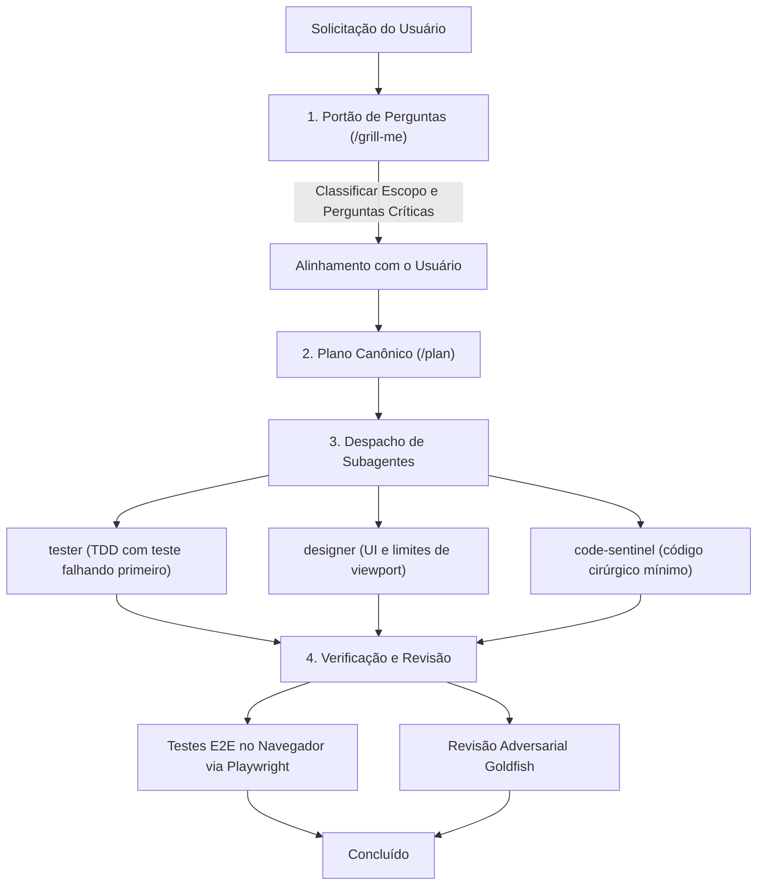

# `heimdall-agent` — Sentinela de Engenharia Multi-Agente e Bootstrapper de Ambiente

<p align="left">
  <a href="LICENSE"></a>
  <a href="https://nodejs.org">= 18" /></a>
  <a href="#8-personas-de-agentes-predefinidas"></a>
  <a href="#inventario-de-skills-50-modulos-em-16-toolkits"></a>
  <a href="#ferramentas-e-runtimes-suportados"></a>
</p>

🌐 **Idioma / Language:** [English](README.md) | **Português (Brasil)**

O Heimdall é um toolkit portátil de bootstrap e sentinela de qualidade para engenharia de software multi-agente. Ele impõe portões de planejamento antes da geração de código, previne *AI slop* (código e texto genérico de IA), isola fronteiras de módulos e sincroniza **8 personas de agentes especializados** e **50 skills modulares** entre **Google Antigravity**, **Claude Code**, **OpenAI Codex CLI**, **Hermes Agent**, **OpenClaw**, **OpenDesign** e **Claude Desktop**.

---

<a id="indice"></a>
## Índice

- [1. O que é o Heimdall?](#1-o-que-e-o-heimdall)
- [2. O que ele faz](#2-o-que-ele-faz)
- [3. Como funciona (Arquitetura, Arquivos e Hooks)](#3-como-funciona)
- [4. Como instalar](#4-como-instalar)
- [5. Como usar (CLI e Comandos Slash)](#5-como-usar)
- [6. Lista completa de Skills e Agentes](#6-lista-completa-de-skills-e-agentes)
- [7. Ferramentas complementares](#7-ferramentas-complementares)
- [Licença](#licenca)

---

<a id="1-o-que-e-o-heimdall"></a>
## 1. O que é o Heimdall?

O **Heimdall** é um bootstrapper de ambiente e camada de coordenação multi-agente para ferramentas de programação com IA.

Em vez de manter manualmente instruções customizadas, prompts de sistema e arquivos de configuração espalhados em diferentes clientes de IA, o Heimdall fornece uma fonte única da verdade (*Single Source of Truth*):
* **Skills Modulares**: 50 capacidades ativadas sob demanda por tarefa (como modelagem de banco de dados, auditoria de segurança, aplicação de design tokens e depuração sistemática) que carregam apenas quando necessário, economizando tokens de contexto.
* **Personas de Agentes Especializados**: 8 papéis predefinidos com janelas de contexto isoladas (`orchestrator`, `tester`, `frontend-designer`, `mobile-designer`, `reviewer`, `security-auditor`, `database-architect`, `code-sentinel`).
* **Doutrina Universal**: Regras centrais (`AGENTS.md`) sincronizadas em todas as ferramentas, exigindo portões de planejamento, desenvolvimento orientado a testes (TDD) e edições cirúrgicas mínimas.

O Heimdall roda em **Windows, macOS e Linux**, usando *junctions* e *symlinks* nativos do sistema de arquivos para manter todas as ferramentas sincronizadas sem duplicação de arquivos.

[↑ Voltar ao topo](#indice)

---

<a id="2-o-que-ele-faz"></a>
## 2. O que ele faz

O Heimdall transforma assistentes de código comuns em equipes de engenharia multi-agente disciplinadas:

1. **Impõe Portões Interativos de Planejamento**: Interrompe a geração imediata de código em tarefas complexas. Questiona requisitos, faz perguntas críticas sobre modos de falha e apresenta alternativas arquiteturais antes de travar o plano.
2. **Elimina AI Slop e Restringe Código**: Aplica as diretrizes de simplicidade de Karpathy (50 linhas em vez de 200, apenas edições cirúrgicas) e remove enrolação conversacional, comentários redundantes e padrões visuais clichês de IA.
3. **Exige Test-Driven Development (TDD)**: Requer testes automatizados falhando antes da escrita do código de implementação. Proíbe pseudo-verificação (`curl 200`, `grep`, status de container).
4. **Exige Testes E2E de Navegador com Playwright**: Determina verificação ativa em navegador real via Playwright para qualquer interface interativa ou mudança visível ao usuário.
5. **Revisão de Código Adversarial**: Despacha revisores sem viés de contexto conversacional para inspecionar `git diffs` em busca de casos de borda, regressões silenciosas e falhas não tratadas.
6. **Intercepta Operações Perigosas**: Avalia comandos shell e mutações de arquivos por meio de hooks de ciclo de vida para bloquear exclusões destrutivas na raiz e *force-pushes* em branches protegidas.

### Comparação: IA Padrão vs. Com Heimdall

| Área | IA Padrão (Vanilla) | Com Heimdall |
| :--- | :--- | :--- |
| **Prompt Inicial** | A IA gera imediatamente 300 linhas de código não verificado. | **Portão Interativo**: A IA pausa, questiona casos de borda e apresenta 2 opções arquiteturais. |
| **Revisão de Código** | A IA aprova o próprio código com elogios superficiais. | **Revisão Cega ao Contexto**: Revisor independente analisa o diff sem viés da conversa. |
| **Contenção de Código** | Wrappers inchados, código defensivo desnecessário, opções especulativas. | **Simplicidade Karpathy**: Código mínimo, edições cirúrgicas, zero refatoração não solicitada. |
| **Verificação** | A IA diz "pronto!" sem testar ou usa checagens superficiais. | **TDD & Playwright**: Teste falhando primeiro; asserções reais de DOM no navegador para UI. |
| **Segurança Operacional** | A IA pode rodar comandos destrutivos ou dar force push na `main`. | **Hooks de Ciclo de Vida**: Bloqueia `rm -rf /` e force pushes em `main`/`master` em runtime e no Git. |
| **Configuração** | Arquivos de prompt espalhados e desatualizados entre várias ferramentas. | **Fonte Única da Verdade**: Vinculada via junctions/symlinks nativos em 1 segundo. |

[↑ Voltar ao topo](#indice)

---

<a id="3-como-funciona"></a>
## 3. Como funciona (Arquitetura, Arquivos e Hooks)

O Heimdall atua entre seus clientes de IA e sua base de código, implantando arquivos padronizados, hooks e doutrinas em todo o sistema.

### 1. Arquivos e Diretórios Gerenciados

Durante o bootstrap, o Heimdall cria *junctions* (Windows) ou *symlinks* (POSIX) deste repositório para os diretórios de configuração das ferramentas alvo:

| Origem no Heimdall | Local Implantado | Finalidade |
| :--- | :--- | :--- |
| `skills/` | `~/.<ferramenta>/skills/` | 50 toolkits de domínio carregados progressivamente sob demanda. |
| `agents/` | `~/.<ferramenta>/agents/` | 8 definições de personas de agentes especializados. |
| `hooks/` | `~/.claude/hooks/` | Hooks de ciclo de vida orientados a eventos para o Claude Code CLI. |
| `hooks/git/` | `.git/hooks/` (opcional) | Hook Git `pre-push` nativo universal para todas as ferramentas. |
| `doctrine/AGENTS.md` | `~/.claude/CLAUDE.md`<br>`~/.gemini/GEMINI.md`<br>`~/.codex/AGENTS.md`<br>`~/.hermes/AGENTS.md` | Doutrina universal entre agentes e restrições operacionais. |
| `playbooks/` | `~/.<ferramenta>/playbooks/` | Playbooks operacionais (portão de perguntas, TDD, revisões, planos). |
| `commands/` | `~/.claude/commands/` | Comandos slash (`/orchestrator`, `/orchestrate`, `/plan`, `/grill-me`). |
| `tools/` | Diretório no `PATH` | Scripts de ponte entre modelos (`claude-bridge`, `gemini-bridge`, `codex-bridge`) e CLI `heimdall`. |

### 2. O Modelo Elefante-Peixe-Dourado do Google (EGM)

O Heimdall adota a divisão central de trabalho do [`google/elephant-goldfish-model`](https://github.com/google/elephant-goldfish-model):

* **O Elefante (Coordenador)**: A sessão principal e a persona [`orchestrator`](#8-personas-de-agentes-predefinidas) retêm a memória de longo prazo, a narrativa do projeto e o histórico profundo de contexto.
* **O Peixe-Dourado (Revisores e Testadores)**: Subagentes despachados para revisão de código (`reviewer`) e diagnóstico de bugs (`tester`) são intencionalmente isolados do histórico de conversa e dos debates do autor. Eles avaliam `git diffs` brutos e critérios de aceite diretamente, prevenindo viés de confirmação.
* **Escada de Fronteira em 3 Níveis (3-Tier Boundary Ladder)**:
  - **Tier 1 (Spike / Bugfix < 50 LOC)**: Zero cerimônia. Código cirúrgico mínimo com teste falhando primeiro.
  - **Tier 2 (Feature Delimitada)**: Verificação rápida de design no chat com revisões de crítica e prontidão.
  - **Tier 3 (Arquitetural)**: Especificação gravada em disco (`docs/designs/<feature>.md`), revisão em 4 estágios (Zoom Out, Compreensão, Crítica, Prontidão) e ledger de convergência de até 5 rodadas.
* **Execução Multi-Modelo Adaptativa**: Se as pontes entre modelos (`gemini-bridge.ps1`, `claude-bridge.ps1`, `codex-bridge.ps1`) e credenciais estiverem presentes, o Heimdall roteia revisões entre modelos distintos (ex.: Elefante Gemini validado por Claude/Codex); caso contrário, recorre automaticamente a subagentes independentes no mesmo modelo.

### 3. Hooks de Ciclo de Vida Orientados a Eventos

O Heimdall inclui hooks de execução sem dependências externas ([`hooks/heimdall-hook.cjs`](hooks/heimdall-hook.cjs)) registrados em `~/.claude/settings.json`:

* **`PreToolUse` (Bash/PowerShell)**:
  - **Bloqueia Comandos Destrutivos**: Interrompe operações como `rm -rf /` ou `rmdir /s /q C:\` (exit code 2).
  - **Proteção de Force Push Sensível à Branch**: Bloqueia `git push --force` direcionado a `main`, `master`, `release` ou `production` (explicitamente ou quando posicionado nessas branches). Force pushes em branches de trabalho (`feature/*`, `bugfix/*`) são permitidos com aviso.
  - **Bloqueia Commits de Segredos**: Impede o stage de arquivos `.env`, `id_rsa` ou `*.pem` não criptografados.
* **`PreToolUse` (Write)**:
  - **Aviso de Contenção Karpathy**: Emite alerta caso a IA tente gerar um único arquivo com mais de 800 linhas.
* **`PostToolUse` (Edit/Write)**:
  - **Lembrete de Verificação**: Lembra o agente de rodar suítes de teste automatizadas ou verificação no navegador antes de concluir.
* **`PreCompact`**:
  - **Lembrete de Persistência Pré-Compactação**: Lembra o agente de salvar decisões abertas e o estado das tarefas em disco antes da compressão de contexto.
* **Hook Git Pre-Push Nativo Universal** ([`hooks/git/pre-push`](hooks/git/pre-push)):
  - Hook shell instalável em qualquer repositório (`.git/hooks/pre-push`) que bloqueia pushes non-fast-forward para `main`/`master` em todas as ferramentas de IA e terminais.

*(Consulte a [Seção 6: Lista completa de Skills e Agentes](#6-lista-completa-de-skills-e-agentes) para o inventário detalhado).*

[↑ Voltar ao topo](#indice)

---

<a id="4-como-instalar"></a>
## 4. Como instalar

### Instalação Rápida Automatizada (Recomendado)

Clone o repositório e execute o script de configuração com junctions ativas:

```powershell
# 1. Clonar o repositório
git clone https://github.com/bepaldes/heimdall-agent.git
cd heimdall-agent

# 2. Inicializar o ecossistema completo com junctions ativas
node setup.mjs --clean --link --yes
```

> **Assistente Interativo**: Execute `node setup.mjs` sem flags para selecionar interativamente ferramentas específicas, caminhos de destino e perfis.

### Perfis de Instalação

Escolha o perfil de acordo com sua máquina e fluxo de trabalho:

| Perfil | Skills | Agentes Predefinidos | Descrição | Ideal Para |
| :--- | :---: | :---: | :--- | :--- |
| **`full`** *(Padrão)* | 50 | 8 | Suíte completa de engenharia: planejamento, design, segurança, banco de dados e higiene. | Desenvolvimento diário em todas as ferramentas |
| **`minimal`** | 16 | 4 | Núcleo enxuto: `orchestrator`, `tester`, `code-sentinel`, `reviewer`. | Notebooks leves, janelas de contexto menores |
| **`security`** | 12 | 4 | Suíte AppSec: `orchestrator`, `security-auditor`, `tester`, `reviewer`. | Pentest e auditorias pré-deploy |
| **`design`** | 14 | 4 | Frontend e mobile: `orchestrator`, `frontend-designer`, `mobile-designer`, `code-sentinel`. | Design de UI/UX e design systems |

Para implantar um perfil específico:
```powershell
node setup.mjs --profile minimal --link --clean --yes
```

<a id="ferramentas-e-runtimes-suportados"></a>
### Ferramentas e Runtimes Suportados

O Heimdall detecta e configura automaticamente as ferramentas de IA instaladas:

| Ferramenta | Alvo de Detecção | Método de Integração |
| :--- | :--- | :--- |
| **Claude Code CLI** | `claude` no PATH | Junctions em `~/.claude/skills`, `agents`, `commands`, `hooks` + injeção em `settings.json` |
| **Google Antigravity** | `agy` no PATH | Junctions em `~/.gemini/skills`, `agents` e diretório universal `.agents/` |
| **OpenAI Codex CLI** | `codex` no PATH | Junctions em `~/.codex/skills`, `agents` e `AGENTS.md` |
| **Hermes Agent** | `hermes` no PATH / LocalAppData | Junctions em `%LOCALAPPDATA%\hermes\skills` + `external_dirs` no `config.yaml` |
| **OpenClaw** | `openclaw` no PATH | Junctions em `~/.openclaw/skills` + injeção em `AGENTS.md` / `SOUL.md` |
| **OpenDesign** | `open-design` no PATH / `.opendesign` | Modo automático de canvas visual: dispensa portões de perguntas no turno 1, preserva atributos `data-od-*` e aplica `taste-skill` + `antislop-ui` |
| **Claude Desktop** | `%APPDATA%\Claude` | Configura automaticamente o MCP Context7 e playbooks no `claude_desktop_config.json` |

[↑ Voltar ao topo](#indice)

---

<a id="5-como-usar"></a>
## 5. Como usar (CLI e Comandos Slash)

### 1. Comandos Diários da CLI (`heimdall` / `node setup.mjs`)

A instalação cria um executável global `heimdall` no seu PATH (ou via `npm link`). `heimdall` e `node setup.mjs` funcionam de forma idêntica.

```powershell
# Sincronização em 1 segundo após instalar uma nova ferramenta de IA (zero duplicação)
heimdall sync

# Auditar ferramentas instaladas, endpoints de API ativos e contagem de skills
heimdall audit

# Atualizar o catálogo dinâmico de modelos a partir do seu provedor/proxy ativo
heimdall sync-models

# Navegar pelo catálogo canônico de skills e repositórios upstream
heimdall skills

# Inspecionar atualizações upstream e protocolo de revisão de skills
heimdall update-skill ponytail
heimdall update-skill all

# Remover com segurança as skills e personas do Heimdall de todas as ferramentas
heimdall uninstall
```

#### Referência de Parâmetros da CLI

| Flag | Padrão | Descrição | Exemplo |
| :--- | :---: | :--- | :--- |
| `--profile <nome>` | `full` | Perfil de skills: `full`, `minimal`, `security` ou `design`. | `heimdall --profile minimal` |
| `--agents <alvos>` | `all` | Lista de ferramentas separadas por vírgula: `claude`, `gemini`, `codex`, `desktop`, `all`. | `heimdall --agents claude,gemini` |
| `--link` | `true` (rec.) | Implanta skills usando junctions NTFS (Windows) ou symlinks POSIX (macOS/Linux). | `heimdall --link` |
| `--clean` | `false` | Limpa skills antigas do diretório de destino antes de implantar. | `heimdall --clean` |
| `--dry-run` | `false` | Simula a execução e exibe as ações sem modificar o sistema de arquivos. | `heimdall --dry-run` |
| `-y`, `--yes` | `false` | Modo não interativo (pula confirmações do assistente). | `heimdall --yes` |

---

### 2. Usando o Orchestrator e Comandos Slash

O **Orchestrator** é o coordenador-chefe de engenharia do Heimdall. Ele questiona requisitos, cria planos estruturados, despacha subagentes especializados e impõe portões de verificação.

#### Como Acionar o Orchestrator
* **No Claude Code CLI**:
  - `/orchestrator <tarefa>` ou `/orchestrate <tarefa>`: Inicia a orquestração completa para uma tarefa ou feature.
  - `/plan <feature>`: Decompõe uma solicitação em um plano canônico de 7 seções.
  - `/grill-me`: Questiona premissas e explora trade-offs antes de definir a arquitetura.
* **No Google Antigravity**:
  - Alterne para ou mencione a persona `@orchestrator`, ou digite `/plan` / `/grill-me`.
* **No OpenAI Codex CLI e Hermes**:
  - A doutrina universal em `AGENTS.md` ativa automaticamente a disciplina do Orchestrator para qualquer prompt de planejamento ou arquitetura.

#### Fluxo de Trabalho de Orquestração



1. **Portão de Perguntas (Turno 1)**: Classifica o escopo na escada de 3 níveis, verifica o código existente para evitar reinventar a roda, faz 2 a 3 perguntas críticas sobre modos de falha e apresenta 2 alternativas arquiteturais.
2. **Plano Canônico (Turno 2)**: Formula um plano canônico de 7 seções (`playbooks/05-canonical-plan-template.md`).
3. **Execução por Subagentes (Turno 3+)**: O Orchestrator delega tarefas para subagentes isolados com instruções específicas.
4. **Verificação e Revisão**: Exige execução de testes automatizados, verificação E2E real via Playwright e revisão por pares adversarial antes do merge.

[↑ Voltar ao topo](#indice)

---

<a id="6-lista-completa-de-skills-e-agentes"></a>
## 6. Lista completa de Skills e Agentes

<a id="8-personas-de-agentes-predefinidas"></a>
### 8 Personas de Agentes Predefinidas

Todas as personas declaram `model: inherit` para rodar em qualquer modelo ou provedor configurado na sua máquina, sem *vendor lock-in*.

| Persona | Nível de Capacidade | Papel e Responsabilidades | Skills Vinculadas |
| :--- | :--- | :--- | :--- |
| **`orchestrator`** | `deep_reasoning` | Guardião do planejamento (`/grill-me`), questionamento de requisitos, decomposição modular de tarefas, exigência de verificação Playwright E2E e coordenação de subagentes. | `brainstorming`, `writing-plans`, `subagent-driven-development`, `dispatching-parallel-agents`, `using-git-worktrees`, `writing-skills`, `executing-plans` |
| **`frontend-designer`** | `high_polish_vision` | Define leitura de design, hierarquia tipográfica, mapeamento de tokens e estética de UI anti-slop para web. | `taste-skill`, `taste-skill-v1`, `gpt-tasteskill`, `brandkit`, `minimalist-skill`, `brutalist-skill`, `soft-skill`, `antislop-ui`, `antislop-human`, `stitch-skill`, `image-to-code-skill`, `imagegen-frontend-web`, `redesign-skill` |
| **`mobile-designer`** | `responsive_flex_safety` | Segurança de viewport mobile (320px–430px), alvos de toque de 48px, containers flex sem corte de overflow e assets responsivos. | `antislop-layoutmobile`, `antislop-human`, `antislop-ui`, `imagegen-frontend-mobile`, `taste-skill` |
| **`tester`** | `fast_verification` | Impõe TDD estrito e verificação real em navegador (Playwright). Rejeita pseudo-verificação (`curl`, `grep`, `tsc`). | `test-driven-development`, `verification-before-completion`, `systematic-debugging`, `executing-plans` |
| **`security-auditor`** | `deep_assurance_audit` | Sondagem HTTP diferencial dinâmica entre níveis de autenticação, defesas OWASP Top 10 e detecção de padrões inseguros da Trail of Bits. | `strix-security`, `security-audit-sweep`, `owasp-security`, `cloudflare-security-audit`, `snyk-agent-scan`, `trailofbits-audit-context`, `trailofbits-insecure-defaults`, `trailofbits-triage-brocards` |
| **`database-architect`** | `schema_migration_safety` | Governa migrações não destrutivas, normalização, auditoria de planos de query (`EXPLAIN ANALYZE`) e pool de conexões (Postgres/Supabase, SQLite, MySQL). | `postgres-best-practices`, `systematic-debugging`, `karpathy-guidelines` |
| **`code-sentinel`** | `surgical_restraint` | Simplicidade Karpathy: escreve código cirúrgico mínimo, remove comentários redundantes, elimina código morto defensivo e aplica padrões anti-slop. | `karpathy-guidelines`, `ponytail`, `antislop`, `antislop-code`, `antislop-copywriting`, `antislop-human`, `finishing-a-development-branch` |
| **`reviewer`** | `adversarial_diff_eval` | Realiza análise adversarial de diffs, captura regressões silenciosas e erros engolidos, e coordena revisões cruzadas entre modelos. | `requesting-code-review`, `receiving-code-review`, `claude-collaborator`, `gemini-collaborator`, `codex-collaborator`, `using-superpowers`, `diagnosing-superpowers`, `output-skill` |

---

<a id="inventario-de-skills-50-modulos-em-16-toolkits"></a>
### Inventário de Skills (50 Módulos em 16 Toolkits)

O Heimdall organiza as capacidades em **5 Suítes Multi-Skill Principais (39 módulos)** e **11 Toolkits Independentes (11 módulos)**:

#### Suítes Multi-Skill Principais (5 Suítes / 39 Módulos)

<details open>
<summary><b>1. Suíte de Engenharia Superpowers (15 módulos) — Jesse Vincent / obra</b></summary>

- `brainstorming`: Expõe premissas implícitas e explora alternativas antes de travar o design.
- `writing-plans`: Estrutura tarefas modulares e objetivas com critérios verificáveis de conclusão.
- `executing-plans`: Impõe verificação passo a passo e interrompe a execução diante de falhas inesperadas.
- `subagent-driven-development`: Decompõe tarefas grandes em subagentes isolados com escopos dedicados.
- `dispatching-parallel-agents`: Coordena subagentes trabalhando em paralelo em branches independentes.
- `test-driven-development`: Exige testes automatizados falhando antes da lógica de implementação.
- `systematic-debugging`: Isola causas-raiz usando teste científico de hipóteses e heurísticas de triagem de build.
- `verification-before-completion`: Exige suítes de testes passando e verificação ao vivo antes de declarar conclusão.
- `finishing-a-development-branch`: Verifica higiene da branch, testes e documentação antes do merge.
- `using-git-worktrees`: Gerencia branches paralelas de execução de agentes sem sujar a árvore de trabalho principal.
- `requesting-code-review`: Formata o contexto estruturado do diff para revisão adversarial por pares.
- `receiving-code-review`: Analisa críticas objetivamente e implementa recomendações verificadas.
- `using-superpowers`: Playbook operacional multi-agente para desenvolvimento de software complexo.
- `diagnosing-superpowers`: Verificação de integridade e diagnóstico de ferramentas de agentes e resolução de skills.
- `writing-skills`: Cria novas skills modulares seguindo contratos padronizados de frontmatter e gatilhos.

</details>

<details>
<summary><b>2. Estúdio de Design e Estética Taste (12 módulos)</b></summary>

- `taste-skill`: Impõe leitura coesa de design, tipografia intencional e lógica de cores orientada à marca.
- `taste-skill-v1`: Heurísticas base de hierarquia visual e equilíbrio de layout.
- `gpt-tasteskill`: Estrutura de avaliação estética e crítica de interfaces.
- `brandkit`: Gerencia design tokens, ativos invariantes de marca e temas multi-paleta.
- `brutalist-skill`: Layouts tipográficos de alto contraste com tensão estrutural deliberada.
- `minimalist-skill`: Layouts editoriais limpos com foco em tipografia, espaço e contenção visual.
- `soft-skill`: Microinterações táteis, elevação sutil e transições orgânicas de superfície.
- `redesign-skill`: Elevação visual sistemática de interfaces legadas sem quebrar a lógica existente.
- `image-to-code-skill`: Tradução de alta fidelidade de wireframes/mockups visuais para código de componentes.
- `stitch-skill`: Integração de layout entre componentes e alinhamento de fluxo responsivo.
- `imagegen-frontend-web`: Geração de ativos visuais e placeholders otimizados para web.
- `imagegen-frontend-mobile`: Estruturação de imagens em proporções e resoluções nativas para mobile.

</details>

<details>
<summary><b>3. Suíte de Qualidade Anti-Slop (6 módulos) — Jesse Vincent / obra</b></summary>

- `antislop`: Guardrail central que proíbe enrolação genérica de IA, chavões vazios e excessos decorativos.
- `antislop-code`: Proíbe comentários redundantes, código morto defensivo e abstrações especulativas.
- `antislop-copywriting`: Bane jargões típicos de IA (*desbloquear, elevar, robusto*), introduções vazias e falso tom de autoridade.
- `antislop-ui`: Rejeita gradientes roxos genéricos, bordas arredondadas uniformes sem propósito e dark modes mal justificados.
- `antislop-human`: Impõe contraste WCAG AAA, HTML semântico e alvos interativos acessíveis.
- `antislop-layoutmobile`: Garante segurança de flexbox responsivo, zero corte de conteúdo e espaçamento adequado para toque.

</details>

<details>
<summary><b>4. Pontes Tri-Direcionais Entre Modelos (3 módulos)</b></summary>

- `claude-collaborator`: Ponte de delegação entre modelos para Claude Opus / Sonnet voltada a revisão arquitetural profunda.
- `gemini-collaborator`: Ponte de delegação para Google Antigravity / Gemini voltada a varreduras rápidas de código.
- `codex-collaborator`: Ponte de delegação para OpenAI Codex CLI voltada a revisões adversariais de código.

</details>

<details>
<summary><b>5. Suíte AppSec de Alta Confiabilidade Trail of Bits (3 módulos) — Trail of Bits</b></summary>

- `trailofbits-audit-context`: Mapeamento de premissas, garantias de código e dependências arquiteturais críticas.
- `trailofbits-insecure-defaults`: Detecção de configurações padrão inseguras, padrões *fail-open* e permissões excessivas.
- `trailofbits-triage-brocards`: Avaliação sistemática de relatórios de vulnerabilidade com base em 7 princípios fundamentais.

</details>

#### Toolkits Independentes (11 Toolkits Curados / 11 Módulos)

<details open>
<summary><b>Explorar Toolkits Independentes</b></summary>

- **`ponytail`**: Disciplina pragmática de desenvolvedor sênior. Aplica a Escada de Decisão de Dietrich Gebert: checagens YAGNI, reuso da base existente, biblioteca padrão da linguagem, recursos nativos da plataforma e zero abstrações prematuras.
- **`karpathy-guidelines`**: Heurísticas de simplicidade de Andrej Karpathy: escrever código cirúrgico mínimo, rejeitar configurabilidade especulativa, expor premissas ocultas e nunca tocar em código adjacente que já funciona.
- **`caveman`**: Protocolo de redução de tokens de Julius Brussee que corta cerimônias conversacionais preservando código bruto, comandos shell e diffs estruturados.
- **`strix-security`**: Sondagem diferencial HTTP dinâmica e autônoma entre contextos de identidade Anônimo, Sem Privilégio e Privilegiado.
- **`security-audit-sweep`**: Auditoria de segurança em 4 fases cobrindo proteção de rotas, menor privilégio em IAM, vulnerabilidades em dependências e vazamento de segredos.
- **`owasp-security`**: Blindagem de código contra OWASP Top 10:2025, ASVS 5.0, LLM Top 10 e riscos em aplicações baseadas em agentes.
- **`cloudflare-security-audit`**: Segurança de borda (edge), configuração de WAF e controle estrito de fronteiras CORS.
- **`snyk-agent-scan`**: Varredura automatizada de skills de IA, configurações MCP e cadeia de suprimentos contra *prompt injection* e vazamento de credenciais.
- **`postgres-best-practices`**: Diretrizes arquiteturais curadas pela Supabase para modelagem de schemas PostgreSQL, indexação, pool de conexões e políticas RLS.
- **`project-hygiene`**: Varre repositórios em busca de código morto, exports não utilizados, dependências circulares e caches de build obsoletos.
- **`output-skill`**: Garante saídas completas do modelo sem reticências (`...`), blocos de código truncados ou omissões.

</details>

[↑ Voltar ao topo](#indice)

---

<a id="7-ferramentas-complementares"></a>
## 7. Ferramentas complementares

Para programação em par entre múltiplos dispositivos, monitoramento mobile e memória persistente de projeto, o Heimdall se integra com:

* **[Herdr (`herdr.dev`)](https://herdr.dev/)**: Multiplexador de agentes nativo para terminal escrito em Rust. Mantém sessões de agentes em segundo plano persistentes mesmo após quedas de conexão e monitora o status (`working`, `blocked`, `idle`).
* **[OpenDesign (`open-design.ai`)](https://open-design.ai/)**: Workspace open-source e local-first de canvas visual com IA. Executa Claude Code, Codex e Gemini CLI via adaptadores de runtime; o contrato de canvas visual do Heimdall dispensa a geração em canvas de portões de perguntas no turno 1 enquanto impõe `taste-skill`, acessibilidade WCAG AAA e preservação de camadas DOM via `data-od-*`.
* **[Moshi (`getmoshi.app`)](https://getmoshi.app/)**: Cliente mobile (iOS/Android) pareado com sua sessão de terminal. Envia notificações push quando um agente atinge um portão interativo de planejamento e permite aprovação remota.
* **[Graphify (`github.com/Graphify-Labs/graphify`)](https://github.com/Graphify-Labs/graphify)**: Construtor local de grafos de conhecimento de código. Usa análise AST via Tree-sitter em mais de 40 linguagens para gerar mapas determinísticos de dependência sem custo de API de LLM, exportando diretamente para cofres do Obsidian.
* **[Obsidian (`obsidian.md`)](https://obsidian.md/)**: Base de conhecimento local em Markdown. Combinado com cofres gerados pelo Graphify (`[[wikilinks]]`), funciona como memória externa persistente para agentes de IA, carregando contexto arquitetural imediato na inicialização sem varreduras pesadas em tokens.

[↑ Voltar ao topo](#indice)

---

<a id="licenca"></a>
## Licença

MIT © [Bernardo Paldes](https://github.com/bepaldes)

[↑ Voltar ao topo](#indice)
