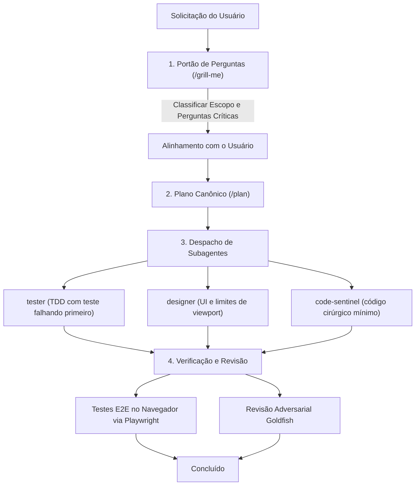

# `heimdall-agent` — Sentinela de Engenharia Multi-Agente e Bootstrapper de Ambiente

<p align="left">
  <a href="LICENSE"></a>
  <a href="https://nodejs.org">= 18" /></a>
  <a href="#10-personas-de-agentes-predefinidas"></a>
  <a href="#inventario-de-skills-71-modulos-em-32-toolkits"></a>
  <a href="#ferramentas-e-runtimes-suportados"></a>
</p>

🌐 **Idioma / Language:** [English](README.md) | **Português (Brasil)**

O Heimdall é um toolkit portátil de bootstrap e sentinela de qualidade para engenharia de software multi-agente. Ele impõe portões de planejamento antes da geração de código, previne *AI slop* (código e texto genérico de IA), isola fronteiras de módulos e sincroniza **10 personas de agentes especializados** e **71 skills modulares** entre **Google Antigravity**, **Claude Code**, **OpenAI Codex CLI**, **Hermes Agent**, **OpenClaw**, **OpenDesign** e **Claude Desktop**.

---

<a id="indice"></a>
## Índice

- [1. O que é o Heimdall?](#1-o-que-e-o-heimdall)
- [2. O que ele faz](#2-o-que-ele-faz)
- [3. Como funciona (Arquitetura, Arquivos e Hooks)](#3-como-funciona)
- [4. Como instalar](#4-como-instalar)
- [5. Como usar (CLI e Comandos Slash)](#5-como-usar)
- [6. Lista completa de Skills e Agentes](#6-lista-completa-de-skills-e-agentes)
- [7. Ferramentas complementares](#7-ferramentas-complementares)
- [Licença](#licenca)

---

<a id="1-o-que-e-o-heimdall"></a>
## 1. O que é o Heimdall?

O **Heimdall** é um bootstrapper de ambiente e camada de coordenação multi-agente para ferramentas de programação com IA. Mais do que um agregador de skills, ele instala uma **maneira completa e opinativa de trabalhar e programar**—combinando comunicação estruturada, prova empírica, contenção cirúrgica de código e hooks de segurança em tempo de execução para construir um ambiente de engenharia determinístico e verificado.

Em vez de manter manualmente instruções customizadas, prompts de sistema e arquivos de configuração espalhados em diferentes clientes de IA, o Heimdall fornece uma fonte única da verdade (*Single Source of Truth*):
* **Skills Modulares**: 71 capacidades ativadas sob demanda por tarefa (como modelagem de banco de dados, auditoria de segurança, aplicação de design tokens, divulgação progressiva e depuração sistemática) que carregam apenas quando necessário, economizando tokens de contexto.
* **Personas de Agentes Especializados**: 10 papéis predefinidos com janelas de contexto isoladas (`orchestrator`, `tester`, `frontend-designer`, `mobile-designer`, `reviewer`, `security-auditor`, `database-architect`, `code-sentinel`, `modernizer`, `cloud-engineer`).
* **Doutrina Universal**: Regras centrais (`AGENTS.md`) sincronizadas em todas as ferramentas, exigindo portões de planejamento, desenvolvimento orientado a testes (TDD) e edições cirúrgicas mínimas.

O Heimdall roda em **Windows, macOS e Linux**, usando *junctions* e *symlinks* nativos do sistema de arquivos para manter todas as ferramentas sincronizadas sem duplicação de arquivos.

[↑ Voltar ao topo](#indice)

---

<a id="2-o-que-ele-faz"></a>
## 2. O que ele faz

O Heimdall transforma assistentes de código comuns em equipes de engenharia multi-agente disciplinadas:

1. **Impõe Portões Interativos de Planejamento**: Interrompe a geração imediata de código em tarefas complexas. Questiona requisitos, faz perguntas críticas sobre modos de falha e apresenta alternativas arquiteturais antes de travar o plano.
2. **Elimina AI Slop e Restringe Código**: Aplica as diretrizes de simplicidade de Karpathy (50 linhas em vez de 200, apenas edições cirúrgicas) e remove enrolação conversacional, comentários redundantes e padrões visuais clichês de IA.
3. **Exige Test-Driven Development (TDD)**: Requer testes automatizados falhando antes da escrita do código de implementação. Proíbe pseudo-verificação (`curl 200`, `grep`, status de container).
4. **Exige Testes E2E de Navegador com Playwright**: Determina verificação ativa em navegador real via Playwright para qualquer interface interativa ou mudança visível ao usuário.
5. **Revisão de Código Adversarial**: Despacha revisores sem viés de contexto conversacional para inspecionar `git diffs` em busca de casos de borda, regressões silenciosas e falhas não tratadas.
6. **Intercepta Operações Perigosas**: Avalia comandos shell e mutações de arquivos por meio de hooks de ciclo de vida para bloquear exclusões destrutivas na raiz e *force-pushes* em branches protegidas.

### A Forma de Trabalhar do Heimdall (Além de um Agregador de Skills)

Skills isoladas não constroem software confiável—**disciplina de engenharia constrói**. O Heimdall incorpora uma metodologia operacional completa em cada sessão:

1. **Arquitetura de Comunicação BLUF (*Bottom Line Up Front*)** (`communication-doctrine`):
   - Elimina rodeios e conclusões escondidas no final da resposta. Todo relatório de status, plano de implementação, veredito de revisão e handoff entre subagentes abre com a decisão, o veredito e o raio de impacto (*blast radius*) nas **primeiras 1–2 frases**.
   - Cabeçalhos padronizados (`Subagent BLUF`, `Review Verdict`, `Plan BLUF`) permitem que coordenadores e engenheiros humanos leiam o resultado em segundos.
2. **Inglês Técnico Simplificado ASD-STE100**:
   - Passos procedimentais começam com **verbos imperativos ativos** (`Create`, `Modify`, `Assert`, `Verify`, `Run`), respeitam limites rígidos de tamanho (**≤ 20 palavras por passo**) e nomeiam objetos explicitamente (sem pronomes ambíguos como *"it"* ou *"this"*).
   - Impõe um **Léxico de Zero Ambiguidade** que proíbe qualificadores vagos (*"ensure"*, *"properly"*, *"appropriately"*, *"gracefully"*, *"as needed"*, *"robustly"*, *"etc."*), substituindo-os por condições exatas e testáveis.
3. **Poteto (`pstack` / `brainmaxxing`) e Artesania de Alto Rigor**:
   - **`pstack-discipline`** (de Lauren Tan / `@poteto`): Impõe *"Prove Que Funciona"* (prova empírica antes de declarar concluído), *"Corrija Causas-Raiz"* (sem guardas que mascaram sintomas), *"Teste Comportamento, Não Implementação"*, *"Subtraia Antes de Adicionar"* e *"Sequencie o Trabalho em Unidades Verificáveis"*.
   - **`ruminate`** (inspirado em `poteto/brainmaxxing`): Minera transcrições históricas de sessões Claude e Gemini em busca de correções do usuário, instruções repetidas, falhas de ativação de skills e desvios de doutrina—transformando atrito passado em arquivos de memória permanentes e emendas de skills.
   - Combinado com **`thermo`** (auditorias de manutenibilidade "Code Judo"), **`karpathy-guidelines`** (edições cirúrgicas mínimas), **`clean-code`** (`ub-mode`), **`ponytail`** (Escada de Decisão de Dietrich Gebert) e **`modern-web-guidance`** (`GoogleChrome/modern-web-guidance`).
4. **Sessões Auto-Evolutivas e Continuidade de Contexto (`ruminate` + `handoff` + Sentinela de Contexto)**:
   - O Heimdall aprende com o próprio histórico: regras no `handoff` (handoff automático ao detectar queda de coerência) e no `writing-plans` (portão de completude de especificação) foram extraídas diretamente de **187 sessões históricas via `/ruminate`**.
   - Durante sessões ativas, o **Sentinela de Contexto** ([`hooks/heimdall-hook.cjs`](hooks/heimdall-hook.cjs)) monitora turnos e uso estimado de tokens contra a janela do modelo ativo (alertando em 75% ou 40 turnos) para que o `handoff` persista o estado limpo antes da degradação do contexto.
5. **Roteamento Dinâmico Multi-Família de Modelos (`lib/model-router.cjs` + `heimdall sync-models`)**:
   - As personas usam `model: inherit` sem aprisionamento a fornecedor. O `heimdall sync-models` e [`lib/model-router.cjs`](lib/model-router.cjs) classificam capacidades dinamicamente, mapeiam personas para níveis de capacidade (`deep_reasoning`, `surgical_restraint`, `adversarial_diff_eval`) e escolhem **revisores de famílias distintas** (ex.: Gemini auditado por Claude, Codex, GLM, Hunyuan ou MiMo).
6. **Contenção de Tokens, Cerimônia e Diffs (`progressive-disclosure` + `caveman` + `ponytail`)**:
   - `progressive-disclosure` carrega skills sob demanda para reduzir o custo de prompt, `caveman` remove cerimônia conversacional e `ponytail` (*Modo Dev Sênior Preguiçoso*, `lite` / `full` / `ultra`) garante o menor diff completo e uma resposta direta que um engenheiro ocupado entende em uma leitura.
7. **Pipeline Matt Pocock ([`mattpocock/skills`](https://github.com/mattpocock/skills)) e os 4 Pilares de Karpathy (`karpathy-guidelines`)**:
   - **Pré-código → Arquitetura → Tickets**: `grill-me` (Árvore de Decisão) → `wayfinder` (resolvido vs. fronteira vs. névoa) → `domain-modeling` (`GLOSSARY.md` e ADRs) → `to-spec` (invariantes) → `to-tickets` (tickets tracer-bullet) → `codebase-design` / `improve-codebase-architecture` (módulos profundos) → `handoff`.
   - **4 Pilares de Karpathy**: *Pensar Antes de Programar* (expor premissas), *Simplicidade Primeiro* (sem helpers especulativos), *Edições Cirúrgicas* (alterar apenas linhas da tarefa) e *Execução Orientada a Metas* (critérios verificáveis antes de editar), reforçados pelo hook `PreToolUse (Write)` de 800 linhas.
8. **Sincronização Controlada de Skills Upstream (`upstream-skill-sync`)**:
   - Classifica cada skill em `config/skills.json` como `mirror`, `adapted` ou `native` e separa atualizações em **Nível 1 (Seguro 1:1)**, **Nível 2 (Merge Seletivo)** ou **Nível 3 (Rejeitar)** após checagem `snyk-agent-scan`.

### Comparação: IA Padrão vs. Com Heimdall

| Área | IA Padrão (Vanilla) | Com Heimdall |
| :--- | :--- | :--- |
| **Prompt Inicial** | A IA gera imediatamente 300 linhas de código não verificado. | **Portão Interativo**: A IA pausa, questiona casos de borda e apresenta 2 opções arquiteturais. |
| **Comunicação** | Prosa prolixa, vereditos escondidos e passos vagos (*"garanta que funcione bem"*). | **BLUF + ASD-STE100**: Veredito nas linhas 1–2; passos imperativos e testáveis com ≤20 palavras. |
| **Revisão de Código** | A IA aprova o próprio código com elogios superficiais. | **Revisão Cega ao Contexto**: Revisor Goldfish independente analisa o diff sem viés da conversa. |
| **Contenção de Código** | Wrappers inchados, código defensivo desnecessário, opções especulativas. | **Disciplina Karpathy & `pstack`**: Subtraia antes de adicionar, corrija causas-raiz, apenas edições cirúrgicas. |
| **Verificação** | A IA diz "pronto!" sem testar ou usa checagens superficiais. | **TDD & Playwright**: Teste falhando primeiro; prova empírica via testes e asserções de DOM no navegador. |
| **Segurança Operacional** | A IA pode abrir dev servers travados, rodar `rm -rf` ou dar force push na `main`. | **Hooks de Ciclo de Vida**: Bloqueia dev servers, comandos destrutivos, segredos e force pushes em runtime e no Git. |
| **Configuração** | Arquivos de prompt espalhados e desatualizados entre várias ferramentas. | **Fonte Única da Verdade**: Vinculada via junctions/symlinks nativos em 1 segundo; autoauditada via `ruminate`. |

[↑ Voltar ao topo](#indice)

---

<a id="3-como-funciona"></a>
## 3. Como funciona (Arquitetura, Arquivos e Hooks)

O Heimdall atua entre seus clientes de IA e sua base de código, implantando arquivos padronizados, hooks e doutrinas em todo o sistema.

### 1. Arquivos e Diretórios Gerenciados

Durante o bootstrap, o Heimdall cria *junctions* (Windows) ou *symlinks* (POSIX) deste repositório para os diretórios de configuração das ferramentas alvo:

| Origem no Heimdall | Local Implantado | Finalidade |
| :--- | :--- | :--- |
| `skills/` | `~/.<ferramenta>/skills/` | 71 toolkits de domínio carregados progressivamente sob demanda. |
| `agents/` | `~/.<ferramenta>/agents/` | 10 definições de personas de agentes especializados. |
| `hooks/` | `~/.claude/hooks/` | Hooks de ciclo de vida orientados a eventos para o Claude Code CLI. |
| `hooks/git/` | `.git/hooks/` (opcional) | Hook Git `pre-push` nativo universal para todas as ferramentas. |
| `doctrine/AGENTS.md` | `~/.claude/CLAUDE.md`<br>`~/.gemini/GEMINI.md`<br>`~/.codex/AGENTS.md`<br>`~/.hermes/AGENTS.md` | Doutrina universal entre agentes e restrições operacionais. |
| `playbooks/` | `~/.<ferramenta>/playbooks/` | Playbooks operacionais (portão de perguntas, TDD, revisões, planos, backlog & fluxo CR). |
| `commands/` | `~/.claude/commands/` | Comandos slash (`/orchestrator`, `/orchestrate`, `/plan`, `/grill-me`, `/council`). |
| `tools/` | Diretório no `PATH` | Executável da CLI `heimdall` e utilitários de inicialização de ambiente. |
| `docs/designs/` | Raiz do workspace | Localização canônica de planos (`YYYY-MM-DD <nome>.md`); planos verificados vão para `old/`. |
| `docs/backlog.md` | Raiz do workspace | Ledger canônico de backlog do produto e Change Requests. |

### 2. Separação de Contexto: Padrão Elephant-Goldfish (Google EGM)

O Heimdall adota a divisão central de trabalho do [`google/elephant-goldfish-model`](https://github.com/google/elephant-goldfish-model):

* **O Elefante (Orquestrador / Memória Longa)**: A sessão principal e a persona [`orchestrator`](#10-personas-de-agentes-predefinidas) preservam a memória contínua, as decisões consolidadas da arquitetura e o contexto de longo prazo.
* **O Goldfish (Revisores e Testadores com Contexto Cego)**: Subagentes acionados para revisão (`reviewer`) e testes (`tester`) recebem exclusivamente o `git diff` e os critérios de aceitação, sem acesso a justificativas ou debates anteriores. Essa amnésia intencional elimina o viés de confirmação e elogios vazios.
* **Governança Gradual em 3 Níveis**:
  - **Nível 1 (Correções Rápidas / Bugfix < 50 linhas)**: Sem burocracia. Edição cirúrgica mínima orientada por testes automatizados.
  - **Nível 2 (Funcionalidades Delimitadas)**: Alinhamento ágil de arquitetura com verificação rápida de viabilidade e prontidão.
  - **Nível 3 (Arquitetura e Alto Impacto)**: Especificação formal persistida em disco (`docs/designs/<feature>.md`), revisão em 4 etapas (Visão Geral, Compreensão, Crítica e Prontidão) e ciclo de convergência com até 5 rodadas.
* **Execução Multi-Modelo Adaptativa**: No ambiente Herdr (`HERDR_ENV=1`), o Heimdall distribui revisões entre modelos distintos (por exemplo, código gerado pelo Gemini sendo auditado pelo Claude ou Codex) em subpainéis nativos; fora do Herdr, recorre a subagentes isolados no mesmo modelo.

### 3. Hooks de Ciclo de Vida Orientados a Eventos

O Heimdall inclui hooks de execução sem dependências externas ([`hooks/heimdall-hook.cjs`](hooks/heimdall-hook.cjs)) declarados em [`hooks/hooks.json`](hooks/hooks.json) e registrados em `~/.claude/settings.json`:

* **`UserPromptSubmit`**:
  - **Injeção da Doutrina de Comunicação**: Reforça BLUF (conclusão nas primeiras 1–2 frases) e regras ASD-STE100 (verbo imperativo primeiro, ≤20 palavras/passo, zero qualificadores proibidos) a cada prompt.
* **`PreToolUse` (Bash/PowerShell)**:
  - **Bloqueia Comandos Destrutivos**: Interrompe operações como `rm -rf /` ou `rmdir /s /q C:\` (exit code 2).
  - **Política Estrita de Zero Dev-Server**: Bloqueia comandos de dev server (`npm run dev`, `vite`, `next dev`, `uvicorn`, `python manage.py runserver`) e exige verificações terminantes não interativas.
  - **Proteção de Force Push Sensível à Branch**: Bloqueia `git push --force` direcionado a `main`, `master`, `release` ou `production` (explicitamente ou quando posicionado nessas branches). Force pushes em branches de trabalho (`feature/*`, `bugfix/*`) são permitidos com aviso.
  - **Bloqueia Commits de Segredos**: Impede o stage de arquivos `.env`, `id_rsa` ou `*.pem` não criptografados.
  - **Sentinela de Contexto (*Context Sentinel*)**: Rastreia turnos da sessão e estimativa de tokens contra o limite do modelo ativo, emitindo alerta em 75% da capacidade ou 40 turnos.
* **`PreToolUse` (Write)**:
  - **Aviso de Contenção Karpathy**: Emite alerta caso a IA tente gerar um único arquivo com mais de 800 linhas (isentando artefatos HTML/SVG/canvas OpenDesign) e atualiza o rastreamento do Sentinela de Contexto.
* **`PreCompact`**:
  - **Reset e Lembrete Pré-Compactação**: Limpa o estado temporário da sessão e lembra o agente de salvar tarefas ativas, decisões e itens pendentes em disco antes da compressão de contexto.
* **Hook Git Pre-Push Nativo Universal** ([`hooks/git/pre-push`](hooks/git/pre-push)):
  - Hook shell instalável em qualquer repositório (`.git/hooks/pre-push`) que bloqueia pushes non-fast-forward para `main`/`master` em todas as ferramentas de IA e terminais.

*(Consulte a [Seção 6: Lista completa de Skills e Agentes](#6-lista-completa-de-skills-e-agentes) para o inventário detalhado).*

[↑ Voltar ao topo](#indice)

---

<a id="4-como-instalar"></a>
## 4. Como instalar

### Opção 1: Instalação Assistida por IA (1 Prompt)

Cole este prompt em qualquer harness de IA com acesso ao terminal local (Claude Code, Antigravity, Codex CLI, Cursor ou Hermes):

```text
Read https://raw.githubusercontent.com/bepaldes/heimdall-agent/main/INSTALL.md and install Heimdall for me.
```

Sua IA solicitará consentimento, executará `node setup.mjs --audit` para detectar harnesses instalados, permitirá escolher um perfil, executará `setup.mjs` de forma determinística e verificará a saúde via `node setup.mjs doctor`.

### Opção 2: Instalação Rápida Automatizada (CLI)

Clone o repositório e execute o script de configuração com junctions ativas:

```powershell
# 1. Clonar o repositório
git clone https://github.com/bepaldes/heimdall-agent.git
cd heimdall-agent

# 2. Inicializar o ecossistema completo com junctions ativas
node setup.mjs --clean --link --yes
```

> **Assistente Interativo**: Execute `node setup.mjs` sem flags para selecionar interativamente ferramentas específicas, caminhos de destino e perfis.

### Perfis de Instalação

Escolha o perfil de acordo com sua máquina e fluxo de trabalho:

| Perfil | Skills | Agentes Predefinidos | Descrição | Ideal Para |
| :--- | :---: | :---: | :--- | :--- |
| **`full`** *(Padrão)* | 71 | 10 | Suíte completa de engenharia: planejamento, design, segurança, banco de dados e higiene. | Desenvolvimento diário em todas as ferramentas |
| **`minimal`** | 18 | 4 | Núcleo enxuto: `orchestrator`, `tester`, `code-sentinel`, `reviewer`. | Notebooks leves, janelas de contexto menores |
| **`security`** | 12 | 4 | Suíte AppSec: `orchestrator`, `security-auditor`, `tester`, `reviewer`. | Pentest e auditorias pré-deploy |
| **`design`** | 13 | 4 | Frontend e mobile: `orchestrator`, `frontend-designer`, `mobile-designer`, `code-sentinel`. | Design de UI/UX e design systems |

Para implantar um perfil específico:
```powershell
node setup.mjs --profile minimal --link --clean --yes
```

<a id="ferramentas-e-runtimes-suportados"></a>
### Ferramentas e Runtimes Suportados

O Heimdall detecta e configura automaticamente as ferramentas de IA instaladas:

| Ferramenta | Alvo de Detecção | Método de Integração |
| :--- | :--- | :--- |
| **Claude Code CLI** | `claude` no PATH | Junctions em `~/.claude/skills`, `agents`, `commands`, `hooks` + injeção em `settings.json` |
| **Google Antigravity** | `agy` no PATH | Junctions em `~/.gemini/skills`, `agents` e diretório universal `.agents/` |
| **OpenAI Codex CLI** | `codex` no PATH | Junctions em `~/.codex/skills`, `agents` e `AGENTS.md` |
| **Hermes Agent** | `hermes` no PATH / LocalAppData | Junctions em `%LOCALAPPDATA%\hermes\skills` + `external_dirs` no `config.yaml` |
| **OpenClaw** | `openclaw` no PATH | Junctions em `~/.openclaw/skills` + injeção em `AGENTS.md` / `SOUL.md` |
| **OpenDesign** | `open-design` no PATH / `.opendesign` | Modo automático de canvas visual: dispensa portões de perguntas no turno 1, preserva atributos `data-od-*` e aplica `taste-skill` + `antislop-ui` |
| **Claude Desktop** | `%APPDATA%\Claude` | Configura automaticamente o MCP Context7 e playbooks no `claude_desktop_config.json` |

### Arquitetura de servidores MCP

O Heimdall gerencia servidores Model Context Protocol (MCP) por meio de um resolvedor baseado em templates que elimina a multiplicação de processos do `npx` no Windows e mantém a configuração consistente em todos os harnesses instalados.

#### Como funciona

1.  **Instalação global de pacotes**: durante a instalação (`node setup.mjs`), o Heimdall instala automaticamente os pacotes MCP necessários via `npm install -g`:
    *   `@upstash/context7-mcp` para consultas atualizadas de documentação de bibliotecas
    *   `chrome-devtools-mcp` para automação de navegador e profiling de performance

2.  **Resolução de templates**: o template portátil em `config/mcp.template.json` declara definições de servidores com tokens `{{PLACEHOLDER}}` e hints de resolução. O script resolvedor (`scripts/resolve-mcp.mjs`) detecta caminhos locais em tempo de execução e gera `config/mcp.resolved.json` com entrypoints diretos via `node.exe`.

3.  **Detecção dinâmica de harnesses**: o resolvedor sincroniza com cada harness instalado verificando a existência do arquivo de configuração. Ele não usa uma lista fixa de alvos:
    *   Gemini escreve em `~/.gemini/config/mcp_config.json` (JSON)
    *   Claude Code escreve em `~/.claude/settings.json` (JSON)
    *   Codex CLI escreve em `~/.codex/config.toml` (TOML `[mcp_servers.*]`)
    *   Hermes escreve em `%LOCALAPPDATA%\hermes\config.yaml` (YAML `mcp_servers:`)
    *   Qualquer harness futuro adicionado ao resolvedor é detectado automaticamente na próxima sincronização

4.  **Invocação direta via `node.exe`**: as configurações resolvidas usam `C:\Program Files\nodejs\node.exe <entrypoint.js>` em vez de `npx`, criando exatamente 1 processo por servidor por sessão, sem wrappers `cmd.exe` e sem multiplicação de órfãos ao fechar a sessão.

#### Comandos diários de MCP

```powershell
# Re-resolve caminhos e sincroniza com todos os harnesses instalados (após ativar/desativar servidores ou atualizar pacotes)
/mcp-sync

# Mata processos MCP órfãos deixados por sessões que travaram
/mcp-cleanup
```

#### Desativar servidores pesados

Edite `config/mcp.template.json` e defina `"disabled": true` no servidor desejado (por exemplo, `chrome-devtools`) para impedir que ele seja iniciado em novas sessões. Execute `/mcp-sync` após editar.

[↑ Voltar ao topo](#indice)

---

<a id="5-como-usar"></a>
## 5. Como usar (CLI e Comandos Slash)

### 1. Comandos Diários da CLI (`heimdall` / `node setup.mjs`)

A instalação cria um executável global `heimdall` no seu PATH (ou via `npm link`). `heimdall` e `node setup.mjs` funcionam de forma idêntica.

```powershell
# Sincronização em 1 segundo após instalar uma nova ferramenta de IA (zero duplicação)
heimdall sync

# Auditar ferramentas instaladas, endpoints de API ativos e contagem de skills
heimdall audit

# Executar verificação determinística de saúde em links, entrypoints MCP e hooks
heimdall doctor
heimdall doctor --json

# Gerar e abrir console diagnóstico HTML estático (sem servidor)
heimdall dashboard
heimdall dashboard --no-open

# Configurar allowlists autônomas multi-OS (safe-dev | full-autonomous | --reset)
heimdall permissions --preset safe-dev
heimdall permissions --preset full-autonomous
heimdall permissions --reset

# Criar nova skill e sincronizar catálogo/docs automaticamente
heimdall create-skill my-skill --category "Collaboration & Process" --profile minimal

# Atualizar o catálogo dinâmico de modelos a partir do seu provedor/proxy ativo
heimdall sync-models

# Otimizar Herdr-App (atalhos de colar/copiar no Windows/macOS/Linux, layout Roundup e mod auto-resume)
heimdall herdr

# Ativar, desativar ou escolher o tema da statusline Heimdall HUD (2 linhas)
heimdall hud
heimdall hud --on --theme night-blue
heimdall hud --off

# Navegar pelo catálogo canônico de skills e repositórios upstream
heimdall skills

# Inspecionar atualizações upstream e protocolo de revisão de skills
heimdall update-skill ponytail
heimdall update-skill all

# Remover com segurança as skills e personas do Heimdall de todas as ferramentas
heimdall uninstall
```

#### Referência de Parâmetros da CLI

| Flag | Padrão | Descrição | Exemplo |
| :--- | :---: | :--- | :--- |
| `--profile <nome>` | `full` | Perfil de skills: `full`, `minimal`, `security` ou `design`. | `heimdall --profile minimal` |
| `--agents <alvos>` | `all` | Lista de ferramentas separadas por vírgula: `claude`, `gemini`, `codex`, `hermes`, `openclaw`, `vscode`, `desktop`, `all`. | `heimdall --agents claude,vscode` |
| `herdr` / `--herdr` | `false` | Configura atalhos do Herdr-App por OS/GUI (Linux/Omarchy `Ctrl+Shift+C`/`V` + `Ctrl+C` SIGINT, Windows `Ctrl+V`, macOS `Cmd+V`), instala o layout `carstenlucke/herdr-roundup` + mods `roundup-*`, filtra harnesses instalados + modelos GhostCLI no menu `+` e instala o mod `heimdall-auto-resume`. | `heimdall herdr` |
| `--theme <nome>` | `night-blue` | Tema de cores do HUD: `night-blue`, `heimdall`, `claude-warm` ou `titanium`. | `heimdall hud --theme claude-warm` |
| `--no-hud` | `false` | Pula a configuração da statusline Heimdall HUD durante a instalação ou sincronização. | `heimdall --no-hud` |
| `--link` | `true` (rec.) | Implanta skills usando junctions NTFS (Windows) ou symlinks POSIX (macOS/Linux). | `heimdall --link` |
| `--clean` | `false` | Limpa skills antigas do diretório de destino antes de implantar. | `heimdall --clean` |
| `--dry-run` | `false` | Simula a execução e exibe as ações sem modificar o sistema de arquivos. | `heimdall --dry-run` |
| `-y`, `--yes` | `false` | Modo não interativo (pula confirmações do assistente). | `heimdall --yes` |

---

### 2. Usando o Orchestrator e Comandos Slash

O **Orchestrator** é o coordenador-chefe de engenharia do Heimdall. Ele questiona requisitos, cria planos estruturados, despacha subagentes especializados e impõe portões de verificação.

#### Como Acionar o Orchestrator
* **No Claude Code CLI**:
  - `/orchestrator <tarefa>` ou `/orchestrate <tarefa>`: Inicia a orquestração completa para uma tarefa ou feature.
  - `/plan <feature>`: Decompõe uma solicitação em um plano canônico de 7 seções.
  - `/grill-me`: Questiona premissas e explora trade-offs antes de definir a arquitetura.
  - `/council <proposta>`: Executa um debate paralelo com 3 personas (roda automaticamente como Tarefa 0 em planos EGM Tier 3).
* **No Google Antigravity**:
  - Alterne para ou mencione a persona `@orchestrator`, ou digite `/plan` / `/grill-me`.
* **No OpenAI Codex CLI e Hermes**:
  - A doutrina universal em `AGENTS.md` ativa automaticamente a disciplina do Orchestrator para qualquer prompt de planejamento ou arquitetura.

#### Fluxo de Trabalho de Orquestração



1. **Portão de Perguntas (Turno 1)**: Classifica o escopo na escada de 3 níveis, verifica o código existente para evitar reinventar a roda, faz 2 a 3 perguntas críticas sobre modos de falha e apresenta 2 alternativas arquiteturais.
2. **Plano Canônico (Turno 2)**: Formula um plano canônico de 7 seções (`playbooks/05-canonical-plan-template.md`).
3. **Execução por Subagentes (Turno 3+)**: O Orchestrator delega tarefas para subagentes isolados com instruções específicas.
4. **Verificação e Revisão**: Exige execução de testes automatizados, verificação E2E real via Playwright e revisão por pares adversarial antes do merge.

---

### 3. Gestão de Backlog e Ciclo de Vida de Planos (Playbook 08)

Para manter a estabilidade da base de código e evitar deriva arquitetural, o Heimdall define dois fluxos distintos:

#### A. Os Quatro Fluxos de Engenharia
1. **Bugfixes (Fast-Path Loop)**: Recebe o relatório -> avalia/planeja a correção cirúrgica -> implementa via TDD (teste falhando primeiro) -> valida com testes e Playwright -> conclui.
2. **Novas Features (Entrada no Backlog)**: Novos requisitos não são codificados imediatamente; são registrados em [`docs/backlog.md`](docs/backlog.md) com contexto e prioridade.
3. **Portão de Análise de Change Request (CR)**: Itens do backlog passam por análise de viabilidade, raio de impacto (*blast radius*) e dependências. Com a aprovação do usuário -> elabora o plano -> implementa -> valida -> arquiva.
4. **Rejeição e Adiamento**: Solicitações descartadas ou adiadas retornam ao backlog com justificativa técnica registrada ou são excluídas.

#### B. Armazenamento e Arquivamento de Planos
* **Criação**: Todos os planos de implementação são criados em `docs/designs/YYYY-MM-DD <nome-do-plano>.md`.
* **Arquivamento**: Após finalização e validação comprovada, o arquivo é movido para `docs/designs/old/YYYY-MM-DD <nome-do-plano>.md`.

[↑ Voltar ao topo](#indice)

---

<a id="6-lista-completa-de-skills-e-agentes"></a>
## 6. Lista completa de Skills e Agentes

<a id="10-personas-de-agentes-predefinidas"></a>
### 10 Personas de Agentes Predefinidas

Todas as personas declaram `model: inherit` para rodar em qualquer modelo ou provedor configurado na sua máquina, sem *vendor lock-in*.

| Persona | Nível de Capacidade | Papel e Responsabilidades | Skills Vinculadas |
| :--- | :--- | :--- | :--- |
| **`orchestrator`** | `deep_reasoning` | Guardião do planejamento (`/grill-me`), questionamento de requisitos, decomposição modular de tarefas, exigência de verificação Playwright E2E e coordenação de subagentes. | `grill-me`, `brainstorming`, `writing-plans`, `to-spec`, `to-tickets`, `wayfinder`, `domain-modeling`, `handoff`, `pstack-discipline`, `subagent-driven-development`, `dispatching-parallel-agents`, `using-git-worktrees`, `writing-skills`, `executing-plans`, `herdr`, `upstream-skill-sync` |
| **`frontend-designer`** | `high_polish_vision` | Define leitura de design, hierarquia tipográfica, mapeamento de tokens e estética de UI anti-slop para web. | `taste-skill`, `brandkit`, `minimalist-skill`, `brutalist-skill`, `soft-skill`, `antislop-ui`, `antislop-human`, `stitch-skill`, `image-to-code-skill`, `imagegen-frontend-web`, `redesign-skill`, `modern-web-guidance` |
| **`mobile-designer`** | `responsive_flex_safety` | Segurança de viewport mobile (320px–430px), alvos de toque de 48px, containers flex sem corte de overflow e assets responsivos. | `antislop-layoutmobile`, `antislop-human`, `antislop-ui`, `imagegen-frontend-mobile`, `taste-skill` |
| **`tester`** | `fast_verification` | Impõe TDD estrito e verificação real em navegador (Playwright). Rejeita pseudo-verificação (`curl`, `grep`, `tsc`). | `test-driven-development`, `verification-before-completion`, `systematic-debugging`, `executing-plans` |
| **`security-auditor`** | `deep_assurance_audit` | Sondagem HTTP diferencial dinâmica entre níveis de autenticação, defesas OWASP Top 10 e detecção de padrões inseguros da Trail of Bits. | `strix-security`, `security-audit-sweep`, `owasp-security`, `cloudflare-security-audit`, `snyk-agent-scan`, `trailofbits-audit-context`, `trailofbits-insecure-defaults`, `trailofbits-triage-brocards` |
| **`database-architect`** | `schema_migration_safety` | Governa migrações não destrutivas, normalização, auditoria de planos de query (`EXPLAIN ANALYZE`) e pool de conexões (Postgres/Supabase, SQLite, MySQL). | `postgres-best-practices`, `systematic-debugging`, `karpathy-guidelines` |
| **`code-sentinel`** | `surgical_restraint` | Simplicidade Karpathy: escreve código cirúrgico mínimo, remove comentários redundantes, elimina código morto defensivo, exige módulos profundos e aplica padrões anti-slop. | `communication-doctrine`, `karpathy-guidelines`, `clean-code`, `codebase-design`, `ponytail`, `antislop`, `antislop-code`, `antislop-copywriting`, `antislop-human`, `finishing-a-development-branch` |
| **`reviewer`** | `adversarial_diff_eval` | Realiza análise adversarial de diffs, audita profundidade de módulos e abstrações rasas, captura regressões silenciosas, executa auditorias thermo e coordena revisões cruzadas entre modelos. | `communication-doctrine`, `thermo`, `codebase-design`, `requesting-code-review`, `receiving-code-review`, `claude-collaborator`, `gemini-collaborator`, `codex-collaborator`, `using-superpowers`, `diagnosing-superpowers`, `output-skill` |
| **`modernizer`** | `legacy_migration_safety` | Executa transformações de código legado, upgrades de runtime, desacoplamento de dependências e migrações Strangler Fig protegidas por testes de caracterização Golden Master. | `test-driven-development`, `verification-before-completion`, `systematic-debugging`, `improve-codebase-architecture`, `codebase-design`, `karpathy-guidelines`, `project-hygiene`, `output-skill`, `modern-web-guidance`, `upstream-skill-sync` |
| **`cloud-engineer`** | `infra_container_safety` | Governa conteinerização (Docker, Compose), manifestos Kubernetes, Infraestrutura como Código (Terraform), proxies reversos (Caddy, Nginx), CI/CD e verificação terminante. | `communication-doctrine`, `karpathy-guidelines`, `clean-code`, `systematic-debugging`, `project-hygiene`, `progressive-disclosure` |

---

<a id="inventario-de-skills-71-modulos-em-32-toolkits"></a>
### Inventário de Skills (71 Módulos em 32 Toolkits)

O Heimdall organiza as capacidades em **6 Suítes Multi-Skill Principais (45 módulos)** e **26 Toolkits Independentes (26 módulos)**:

#### Suítes Multi-Skill Principais (6 Suítes / 45 Módulos)

<details open>
<summary><b>1. Suíte de Engenharia Superpowers (15 módulos) — <a href="https://github.com/obra/superpowers">obra/superpowers</a></b></summary>

- `brainstorming`: Expõe premissas implícitas e explora alternativas antes de travar o design.
- `writing-plans`: Estrutura tarefas modulares e objetivas com critérios verificáveis de conclusão.
- `executing-plans`: Impõe verificação passo a passo e interrompe a execução diante de falhas inesperadas.
- `subagent-driven-development`: Decompõe tarefas grandes em subagentes isolados com escopos dedicados.
- `dispatching-parallel-agents`: Coordena subagentes trabalhando em paralelo em branches independentes.
- `test-driven-development`: Exige testes automatizados falhando antes da lógica de implementação.
- `systematic-debugging`: Isola causas-raiz usando teste científico de hipóteses e heurísticas de triagem de build.
- `verification-before-completion`: Exige suítes de testes passando e verificação ao vivo antes de declarar conclusão.
- `finishing-a-development-branch`: Verifica higiene da branch, testes e documentação antes do merge.
- `using-git-worktrees`: Gerencia branches paralelas de execução de agentes sem sujar a árvore de trabalho principal.
- `requesting-code-review`: Formata o contexto estruturado do diff para revisão adversarial por pares.
- `receiving-code-review`: Analisa críticas objetivamente e implementa recomendações verificadas.
- `using-superpowers`: Playbook operacional multi-agente para desenvolvimento de software complexo.
- `diagnosing-superpowers`: Verificação de integridade e diagnóstico de ferramentas de agentes e resolução de skills.
- `writing-skills`: Cria novas skills modulares seguindo contratos padronizados de frontmatter e gatilhos.

</details>

<details>
<summary><b>2. Estúdio de Design e Estética Taste (10 módulos) — <a href="https://github.com/Leonxlnx/taste-skill">Leonxlnx/taste-skill</a></b></summary>

- `taste-skill`: Impõe leitura coesa de design, tipografia intencional e lógica de cores orientada à marca.
- `brandkit`: Gerencia design tokens, ativos invariantes de marca e temas multi-paleta.
- `brutalist-skill`: Layouts tipográficos de alto contraste com tensão estrutural deliberada.
- `minimalist-skill`: Layouts editoriais limpos com foco em tipografia, espaço e contenção visual.
- `soft-skill`: Microinterações táteis, elevação sutil e transições orgânicas de superfície.
- `redesign-skill`: Elevação visual sistemática de interfaces legadas sem quebrar a lógica existente.
- `image-to-code-skill`: Tradução de alta fidelidade de wireframes/mockups visuais para código de componentes.
- `stitch-skill`: Integração de layout entre componentes e alinhamento de fluxo responsivo.
- `imagegen-frontend-web`: Geração de ativos visuais e placeholders otimizados para web.
- `imagegen-frontend-mobile`: Estruturação de imagens em proporções e resoluções nativas para mobile.

</details>

<details>
<summary><b>3. Suíte de Qualidade Anti-Slop (6 módulos) — <a href="https://github.com/miqdadbadjuber/anti-slop">miqdadbadjuber/anti-slop</a></b></summary>

- `antislop`: Guardrail central que proíbe enrolação genérica de IA, chavões vazios e excessos decorativos.
- `antislop-code`: Proíbe comentários redundantes, código morto defensivo e abstrações especulativas.
- `antislop-copywriting`: Bane jargões típicos de IA (*desbloquear, elevar, robusto*), introduções vazias e falso tom de autoridade.
- `antislop-ui`: Rejeita gradientes roxos genéricos, bordas arredondadas uniformes sem propósito e dark modes mal justificados.
- `antislop-human`: Impõe contraste WCAG AAA, HTML semântico e alvos interativos acessíveis.
- `antislop-layoutmobile`: Garante segurança de flexbox responsivo, zero corte de conteúdo e espaçamento adequado para toque.

</details>

<details>
<summary><b>4. Pontes Tri-Direcionais Entre Modelos (3 módulos)</b></summary>

- `claude-collaborator`: Ponte de delegação entre modelos para Claude Opus / Sonnet voltada a revisão arquitetural profunda.
- `gemini-collaborator`: Ponte de delegação para Google Antigravity / Gemini voltada a varreduras rápidas de código.
- `codex-collaborator`: Ponte de delegação para OpenAI Codex CLI voltada a revisões adversariais de código.

</details>

<details>
<summary><b>5. Suíte AppSec de Alta Confiabilidade Trail of Bits (3 módulos) — <a href="https://github.com/trailofbits/skills">trailofbits/skills</a></b></summary>

- `trailofbits-audit-context`: Mapeamento de premissas, garantias de código e dependências arquiteturais críticas.
- `trailofbits-insecure-defaults`: Detecção de configurações padrão inseguras, padrões *fail-open* e permissões excessivas.
- `trailofbits-triage-brocards`: Avaliação sistemática de relatórios de vulnerabilidade com base em 7 princípios fundamentais.

</details>

<details>
<summary><b>6. Suíte de Engenharia Real Matt Pocock (8 módulos) — <a href="https://github.com/mattpocock/skills">mattpocock/skills</a></b></summary>

- `codebase-design`: Modela módulos profundos — interfaces enxutas que encapsulam alta complexidade interna —, aplica o teste de deleção e elimina camadas superficiais de abstração.
- `domain-modeling`: Modela a linguagem ubíqua da aplicação, estrutura glossários de termos de negócio e formaliza Registros de Decisão Arquitetural (ADRs) para evitar divergências conceituais.
- `improve-codebase-architecture`: Mapeia o acoplamento entre os módulos da base de código, identifica dependências circulares e gera diagnósticos em matriz de dependência.
- `to-spec`: Transforma requisitos e consensos de alinhamento em especificações técnicas detalhadas, com regras invariantes, jornadas de usuário e matrizes de erro.
- `to-tickets`: Desdobra especificações em tarefas atômicas e ordenadas por dependência, prontas para execução estruturada por subagentes.
- `wayfinder`: Rastrea a fronteira de execução em bases de código amplas, separando o que já foi decidido, as tarefas ativas da rodada e as áreas ainda sob análise.
- `grill-me`: Entrevistas técnicas estruturadas pela fronteira de decisões, com investigação autônoma no repositório e formato de aprovação ágil por recomendação explícita (*Yes-to-Approve*).
- `handoff`: Condensa o contexto da sessão em documentos estruturados por ponteiros salvos no diretório temporário (`$env:TEMP`), com contratos explícitos de skills recomendadas para o próximo agente.

</details>

#### Toolkits Independentes (26 Toolkits Curados / 26 Módulos)

<details open>
<summary><b>Explorar Toolkits Independentes</b></summary>

- **`thermo`**: Revisão estrita de arquitetura e manutenibilidade focada em simplificação estrutural ("Code Judo"), eliminação de condicionais espaguete e integridade modular.
- **`pstack-discipline`**: Disciplina de engenharia de alto rigor do ecossistema pstack / poteto: "Prove Que Funciona", "Corrija Causas-Raiz", "Teste Comportamento Não Implementação" e "Subtraia Antes de Adicionar".
- **`communication-doctrine`**: Doutrina de comunicação BLUF (*Bottom Line Up Front*) e STE (*Simplified Technical English*) para agentes de IA, planos de implementação, revisões de código e handoffs entre subagentes.
- **`threat-modeling`**: Modelagem sistemática de ameaças STRIDE, mapeamento de fronteiras de confiança e verificação de mitigações para arquitetura, APIs e infraestrutura de nuvem.
- **`mcp-engineering`**: Padrões, conformidade com protocolo JSON-RPC 2.0, validação de schema e disciplina de transporte stdio/SSE para servidores e ferramentas MCP.
- **`herdr`**: Controle do Herdr, gerenciador de workspaces para agentes de código. Inspecione ou controle painéis, abas, workspaces, comandos e coordene com agentes pares em sessões persistentes (`herdr` no terminal, `herdr-app` como IDE desktop).
- **`clean-code` (`ub-mode`)**: Padrão de engenharia Clean Code de Robert C. "Uncle Bob" Martin. Impõe ciclos TDD, protocolo de menor esforço (*laziness protocol*), questionamento de premissas, modelagem de fronteiras e portões matemáticos de complexidade (CRAP < 10, similaridade DRY < 0.8, testes destruidores de mutantes).
- **`ponytail`**: Disciplina pragmática de desenvolvedor sênior. Aplica a Escada de Decisão de Dietrich Gebert: checagens YAGNI, reuso da base existente, biblioteca padrão da linguagem, recursos nativos da plataforma e zero abstrações prematuras.
- **`karpathy-guidelines`**: Heurísticas de simplicidade de Andrej Karpathy: escrever código cirúrgico mínimo, rejeitar configurabilidade especulativa, expor premissas ocultas e nunca tocar em código adjacente que já funciona.
- **`caveman`**: Protocolo de redução de tokens de Julius Brussee que corta cerimônias conversacionais preservando código bruto, comandos shell e diffs estruturados.
- **`strix-security`**: Sondagem diferencial HTTP dinâmica e autônoma entre contextos de identidade Anônimo, Sem Privilégio e Privilegiado.
- **`security-audit-sweep`**: Auditoria de segurança em 4 fases cobrindo proteção de rotas, menor privilégio em IAM, vulnerabilidades em dependências e vazamento de segredos.
- **`owasp-security`**: Blindagem de código contra OWASP Top 10:2025, ASVS 5.0, LLM Top 10 e riscos em aplicações baseadas em agentes.
- **`cloudflare-security-audit`**: Segurança de borda (edge), configuração de WAF e controle estrito de fronteiras CORS.
- **`snyk-agent-scan`**: Varredura automatizada de skills de IA, configurações MCP e cadeia de suprimentos contra *prompt injection* e vazamento de credenciais.
- **`postgres-best-practices`**: Diretrizes arquiteturais curadas pela Supabase para modelagem de schemas PostgreSQL, indexação, pool de conexões e políticas RLS.
- **`progressive-disclosure`**: Padrão de divulgação progressiva em 3 camadas alinhado à Anthropic e Google, cortando o uso de tokens de prompt em >80% e prevenindo a proliferação desordenada de subagentes.
- **`project-hygiene`**: Varre repositórios em busca de código morto, exports não utilizados, dependências circulares e caches de build obsoletos.
- **`output-skill`**: Garante saídas completas do modelo sem reticências (`...`), blocos de código truncados ou omissões.
- **`ruminate`**: Minera transcrições históricas de sessões Claude e Gemini em busca de padrões de correção, preferências repetidas, falhas de ativação de skills, violações de doutrina e desvios de consistência entre agentes. Escreve descobertas como arquivos de memória ou emendas de skills. Inspirado em [poteto/brainmaxxing](https://github.com/poteto/brainmaxxing).
- **`modern-web-guidance`**: Pacote oficial de skills de plataforma web moderna do Google Chrome (`GoogleChrome/modern-web-guidance`). Orienta agentes a usar APIs nativas HTML/CSS/JS compatíveis com Baseline, boas práticas de Core Web Vitals (LCP/INP/CLS) e modernização frontend via `legacy-scan`.
- **`mcp-cleanup`**: Encerra processos órfãos de servidores MCP deixados por sessões encerradas ou travadas.
- **`mcp-sync`**: Resolve o template MCP do Heimdall para caminhos locais e sincroniza com os harnesses instalados.
- **`upstream-skill-sync`**: Audita repositórios upstream em `config/skills.json` e classifica atualizações em Seguro 1:1, Merge Seletivo ou Rejeitar.
- **`onboard`**: Entrevista o usuário uma vez por workspace para registrar stack, comando de teste, lint/build, alvo de deploy e rigor em `.heimdall/workspace.md`.
- **`council`**: Avalia decisões arquiteturais, PRs ou trade-offs despachando 3 personas especializadas do Heimdall em paralelo e sintetizando consenso vs. conflitos.

</details>

[↑ Voltar ao topo](#indice)

---

<a id="7-ferramentas-complementares"></a>
## 7. Ferramentas complementares

Para programação em par entre múltiplos dispositivos, monitoramento mobile e memória persistente de projeto, o Heimdall se integra com:

* **[Herdr (`herdr.dev`)](https://herdr.dev/)**: Gerenciador de workspaces e multiplexador de agentes escrito em Rust. Mantém sessões de agentes em segundo plano persistentes mesmo após quedas de conexão e monitora o status (`working`, `blocked`, `idle`). Configurações recomendadas:
  - **`herdr` (CLI / Core)**: Multiplexador nativo de terminal e daemon (`herdr-core` / `hc`) leve, recomendado para fluxos de trabalho no terminal e ambientes remotos/headless.
  - **`herdr-app`**: Aplicativo desktop dedicado que oferece uma experiência de IDE "nativa" no Windows (também compatível com macOS e Linux via GPUI/Vulkan) para gerenciamento visual de spaces, abas, painéis divididos e monitoramento de status de agentes em tempo real.
* **[OpenDesign (`open-design.ai`)](https://open-design.ai/)**: Workspace open-source e local-first de canvas visual com IA. Executa Claude Code, Codex e Gemini CLI via adaptadores de runtime; o contrato de canvas visual do Heimdall dispensa a geração em canvas de portões de perguntas no turno 1 enquanto impõe `taste-skill`, acessibilidade WCAG AAA e preservação de camadas DOM via `data-od-*`.
* **[Moshi (`getmoshi.app`)](https://getmoshi.app/)**: Cliente mobile (iOS/Android) pareado com sua sessão de terminal. Envia notificações push quando um agente atinge um portão interativo de planejamento e permite aprovação remota.
* **[Graphify (`github.com/Graphify-Labs/graphify`)](https://github.com/Graphify-Labs/graphify)**: Construtor local de grafos de conhecimento de código. Usa análise AST via Tree-sitter em mais de 40 linguagens para gerar mapas determinísticos de dependência sem custo de API de LLM, exportando diretamente para cofres do Obsidian.
* **[Obsidian (`obsidian.md`)](https://obsidian.md/)**: Base de conhecimento local em Markdown. Combinado com cofres gerados pelo Graphify (`[[wikilinks]]`), funciona como memória externa persistente para agentes de IA, carregando contexto arquitetural imediato na inicialização sem varreduras pesadas em tokens.
* **Heimdall HUD ([`tools/heimdall-hud.mjs`](tools/heimdall-hud.mjs))**: Statusline nativa de 2 linhas para terminal no **Claude Code** e **Google Antigravity (`agy`)**, exibindo modelo, barra de contexto colorida, branch Git e arquivos modificados, consumo de tokens, custo e duração da sessão em 4 temas (`night-blue` padrão, `heimdall`, `claude-warm`, `titanium`). No **Codex CLI** (que não executa scripts externos de `statusLine`), o `heimdall hud` configura os itens nativos `[tui] status_line` em `~/.codex/config.toml`.

[↑ Voltar ao topo](#indice)

---

<a id="licenca"></a>
## Licença

MIT © [Bernardo Paldes](https://github.com/bepaldes)

[↑ Voltar ao topo](#indice)
