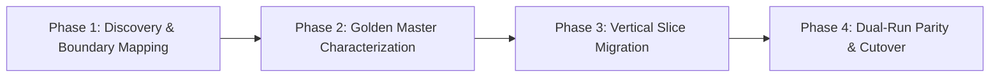

# Playbook 07: Legacy Code Modernization & Transformation

> **For Desktop & Web AI**: Use this playbook whenever undertaking legacy codebase upgrades, runtime migrations, dependency modernizations, or monolithic subsystem refactoring.

---

## 1. Overview & Core Philosophy
Modernizing legacy software using AI coding agents carries a significant risk: models frequently discard critical, undocumented business logic because it looks messy or idiomatic to older language versions. 

This playbook enforces Anthropic's **Code Modernization Playbook** framework: transformations must proceed through disciplined **Characterization Testing (Golden Master)** and **Vertical Slice Migrations**, guaranteeing zero behavioral regressions.

---

## 2. The 4-Phase Modernization Workflow



### Phase 1: Discovery & Boundary Mapping
1. **Identify the Seam**: Locate where the legacy subsystem interacts with the rest of the application (API contracts, DB tables, file I/O, exported functions).
2. **Blast-Radius Assessment**:
   - Classify downstream consumers into Tier 1 (internal non-critical), Tier 2 (user-facing views), or Tier 3 (database mutations, auth, financial transactions).
3. **Document Invariants**: Record all expected input formats, edge cases, and known quirks in `docs/modernization/<subsystem>-invariants.md`.

### Phase 2: Golden Master (Characterization) Test Baseline
> [!CRITICAL]
> **Zero-Mutation Rule**: Do NOT touch, clean up, or refactor legacy code during this phase.

1. **Write Characterization Tests**:
   - Capture real-world inputs and record outputs from the *existing* legacy implementation.
   - Include: valid payloads, malformed inputs, boundary values (null, empty, negative, maximum length), and error conditions.
2. **Lock the Baseline**:
   - Run the tests against the untouched legacy code.
   - Every characterization test must pass (100% baseline).
3. **Commit Baseline**:
   - Commit the characterization suite to git before proceeding to Phase 3.

### Phase 3: Incremental Vertical Slice Migration (Strangler Fig)
1. **Define the Modern Interface**: Author clean TypeScript/Node.js or target language interfaces representing the modernized seam.
2. **Implement Behind an Adapter**:
   - Create a routing adapter that can switch between the legacy implementation and the modernized implementation via an environment variable or feature flag:
     ```typescript
     export async function processTransaction(data: TransactionInput): Promise<TransactionResult> {
       if (process.env.USE_MODERN_TRANSACTIONS === "true") {
         return modernProcessor.execute(data);
       }
       return legacyProcessor.execute(data);
     }
     ```
3. **Surgical Implementation**: Write the modernized implementation adhering strictly to Karpathy simplicity and native platform features.

### Phase 4: Dual-Run Parity & Cutover
1. **Dual-Run Verification**:
   - Run the Golden Master test suite with the feature toggle enabled.
   - Verify that all outputs match the legacy outputs bit-for-bit (or within explicitly documented architectural updates).
2. **Peer Adversarial Review**:
   - Dispatch the diff to the Reviewer (`powershell -File C:/Apps/tools/claude-bridge.ps1 review` or `gemini-bridge.ps1 review`).
3. **Decommissioning**:
   - Remove the feature toggle and safely delete the legacy code branch.

---

## 3. Mandatory Modernization Guardrails

1. **Ban Big-Bang Rewrites**:
   - Any refactoring plan proposing to replace more than 500 lines of legacy code in a single pull request without incremental seams must be rejected.
2. **Preserve Business Quirks**:
   - Never "fix" undocumented behavioral quirks during a modernization pass unless the user explicitly commands the behavioral change.
3. **Automated Rollback Readiness**:
   - Every modernized vertical slice must have an immediate, zero-downtime rollback mechanism (feature toggle or reversible commit) until production stability is established.
