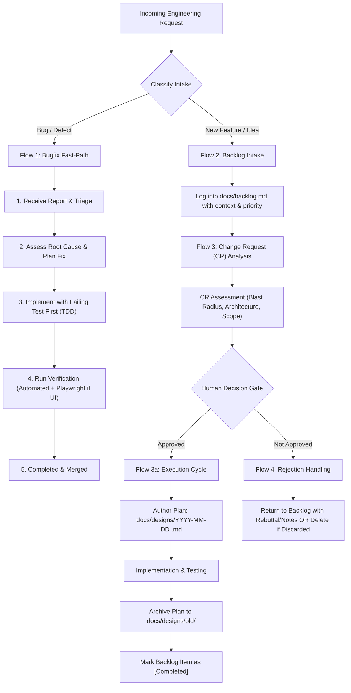

# Playbook 08: Backlog Governance, Change Request (CR) Analysis & Execution Flows

> **For Desktop & Web AI**: Use this operational protocol to govern issue intake, feature backlogs, Change Request (CR) reviews, and implementation lifecycles.

---

## 1. Governance Overview

Heimdall distinguishes between **fast-path bugfixes** and **evaluated feature requests** to maintain stability while preventing architectural drift:



---

## 2. The Four Distinct Lifecycle Flows

### Flow 1: Bugfixes (Fast-Path Loop)
* **Trigger**: Bug report, runtime error, broken assertion, or security defect.
* **Protocol**:
  1. **Receive Report**: Extract steps to reproduce, affected files, error logs, and expected behavior.
  2. **Assess & Plan Fix**: Identify root cause; for <50 LOC (Tier 1), plan surgically in-chat; for complex defects, author a brief plan.
  3. **Implement via TDD**: Write a failing regression test proving the bug exists; implement minimal surgical code until the test passes.
  4. **Verify**: Run full test suite (`pnpm test` / `pytest`) and Playwright E2E if user interface is touched.
  5. **Complete**: Mark resolved, record fix in commit message.

### Flow 2: New Features (Backlog Intake)
* **Trigger**: New requirement, enhancement proposal, or architectural improvement.
* **Protocol**:
  1. **Do not immediately implement.**
  2. Log the item into [`docs/backlog.md`](file:///C:/Apps/heimdall-agent/docs/backlog.md) under `## Active Backlog`.
  3. Capture:
     - **ID**: `FEAT-XXX` or `CR-XXX`
     - **Title**: Descriptive name
     - **Motivation & Details**: Context, target users, business justification
     - **Impact & Estimated Scope**: Tier 1, 2, or 3
     - **Status**: `Backlog` (or `Under Analysis`)

### Flow 3: Change Request (CR) Analysis & Implementation
* **Trigger**: User requests evaluation of a specific backlog item (or a batch sweep of the backlog).
* **Protocol**:
  1. **CR Analysis Phase**:
     - Evaluate technical feasibility, architectural fit, dependency footprint, and blast radius.
     - Review backward compatibility and potential regressions.
     - Present findings clearly:
       - Scope classification (Tier 1, 2, or 3)
       - Architectural impact & trade-offs
       - Effort estimation & model allocation recommendation
  2. **Human Approval Gate**:
     - STOP and wait for explicit user sign-off to proceed.
  3. **Implementation Cycle (Upon Approval)**:
     - **Step A**: Author a formal 7-section plan in:
       `docs/designs/YYYY-MM-DD <feature-name>.md`
     - **Step B**: Execute plan task-by-task following TDD and anti-slop guidelines.
     - **Step C**: Verify thoroughly with automated tests and Playwright E2E.
     - **Step D**: Archive the plan:
       Move `docs/designs/YYYY-MM-DD <feature-name>.md` to `docs/designs/old/YYYY-MM-DD <feature-name>.md`.
     - **Step E**: Update [`docs/backlog.md`](file:///C:/Apps/heimdall-agent/docs/backlog.md), moving item to `## Completed`.

### Flow 4: Rejection & Postponement
* **Trigger**: CR Analysis concludes the feature is out of scope, premature, high risk, or user rejects proposal.
* **Protocol**:
  - **Option 4A (Postpone / Defer)**: Move the item back to `## Active Backlog` or `## Icebox`, appending the rejection rationale, unanswered questions, or blockers.
  - **Option 4B (Delete / Discard)**: If permanently discarded, record in `## Discarded / Rejected` with reason (or delete from the document if instructed by user).

---

## 3. Backlog Document Schema (`docs/backlog.md`)

All projects governed by Heimdall must maintain [`docs/backlog.md`](file:///C:/Apps/heimdall-agent/docs/backlog.md) adhering to this authoritative structure:

```markdown
# Product & Engineering Backlog

## 1. Under Analysis / Change Requests (In-Flight Evaluation)
| ID | Title | Priority | Scope Tier | CR Status | Analysis Notes / Design Link |
| :--- | :--- | :--- | :--- | :--- | :--- |

## 2. Active Backlog (Prioritized Features)
| ID | Title | Priority (P0-P3) | Type (Feature/Enchancement) | Description & Value | Target Milestone |
| :--- | :--- | :--- | :--- | :--- | :--- |

## 3. Icebox / Deferred
| ID | Title | Date Added | Deferral Reason / Unresolved Questions |
| :--- | :--- | :--- | :--- |

## 4. Completed
| ID | Title | Completed Date | Plan Reference (docs/designs/old/) | Verified By |
| :--- | :--- | :--- | :--- | :--- |

## 5. Discarded / Rejected
| ID | Title | Decision Date | Rejection Rationale |
| :--- | :--- | :--- | :--- |
```
