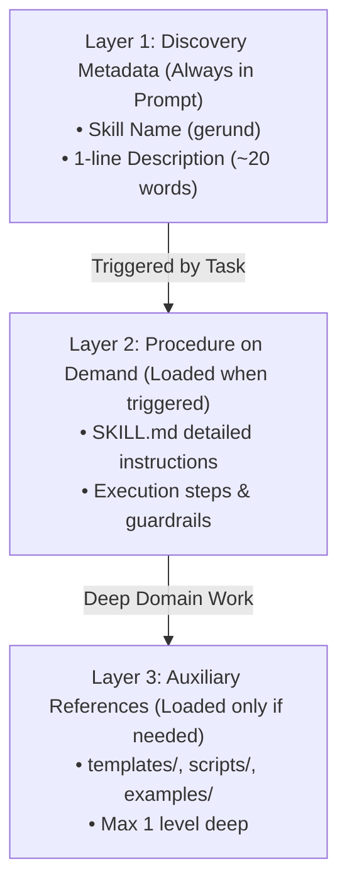

# Progressive Disclosure & Modular Skill Architecture

## Overview
This skill operationalizes Anthropic's guidance from *"Building agents: When to fold subagents into your main agent loop"* (October 2026) and Google's agentic engineering standards.

Defaulting to multi-agent org charts (spawning separate agents for planning, routing, and minor domain steps) introduces severe overhead:
- **3–10× Token Inflation**: Every nested subagent call duplicates system prompts and model invocations.
- **Context Degradation (The Telephone Game)**: Nuances are lost across summaries and handoffs.
- **Subagent Sprawl & The Frankenprompt**: Endless accretion of overlapping prompts that contradict one another.

**The Solution**: A **single main agent loop** powered by **Progressive Disclosure**.

---

## 1. The Three Layers of Progressive Disclosure

### Layer 1: Discovery Metadata (Always Present, Ultra-Light)
- Only the YAML frontmatter `name` and `description` are loaded into the agent's baseline system prompt.
- Descriptions must be concise (<25 words) and explicitly state the trigger conditions using active gerunds (e.g., `optimizing-database-queries`, `designing-ui-components`).
- *Impact*: Cuts initial system prompt token consumption by >80%.

### Layer 2: On-Demand Skill Instructions (`SKILL.md`)
- The agent reads `SKILL.md` only when the active task matches the skill's description.
- Detailed step-by-step algorithms, checklists, and edge-case handling reside here.

### Layer 3: Shallow Reference Assets (`references/`, `examples/`)
- Complex reference tables, boilerplate code, or schemas are kept in separate sibling files within the skill directory.
- Keep references **exactly one level deep** directly linked from `SKILL.md`. Never build deeply nested documentation trees.

---

## 2. When to Fold vs. When Subagents Earn Their Place

Use this decision matrix before spawning a child subagent:

| Scenario | Architectural Choice | Reason |
| :--- | :--- | :--- |
| **Sequential domain task** (e.g., write migration, update schema, test endpoint) | **Main Agent Loop + Skill** | Single loop retains unbroken reasoning chain; 3–5× cheaper and faster. |
| **Tool-heavy workflow** (>30 tools available) | **Tool Search / Deferred Loading** | Tool discovery prevents tool hallucination without requiring child agents. |
| **Stateless Adversarial Review** | **Subagent (Goldfish)** | Invariant requires total blinding from conversational backstory ("Elephant"). |
| **Parallel Fan-out** (3+ independent test fixes or audit sweeps) | **Parallel Subagents** | Concurrent execution across isolated failure domains. |
| **Strict Security / Permission Sandbox** | **Subagent** | Subagent runs with restricted credentials or isolated read-only tools. |

---

## 3. Skill Authoring Checklist

When writing or refactoring any skill in `skills/`:
- [ ] **Name**: Gerund format (`writing-plans`, `diagnosing-superpowers`).
- [ ] **Description**: Concise (<25 words), stating when and why to activate.
- [ ] **No Monolithic Injections**: Large schemas or long text examples moved to `examples/` or `references/`.
- [ ] **Direct File Links**: All reference files linked via relative markdown links.
- [ ] **Clean Exit Criteria**: Explicit conditions defining when the skill procedure is complete.
